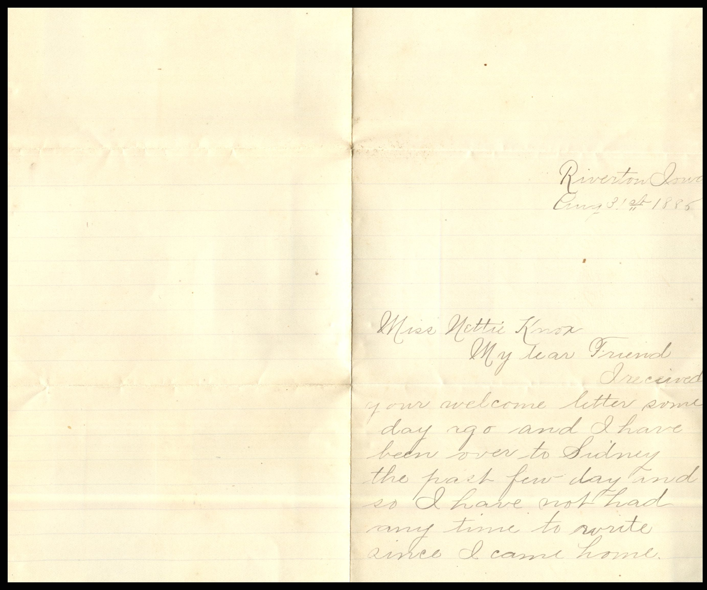
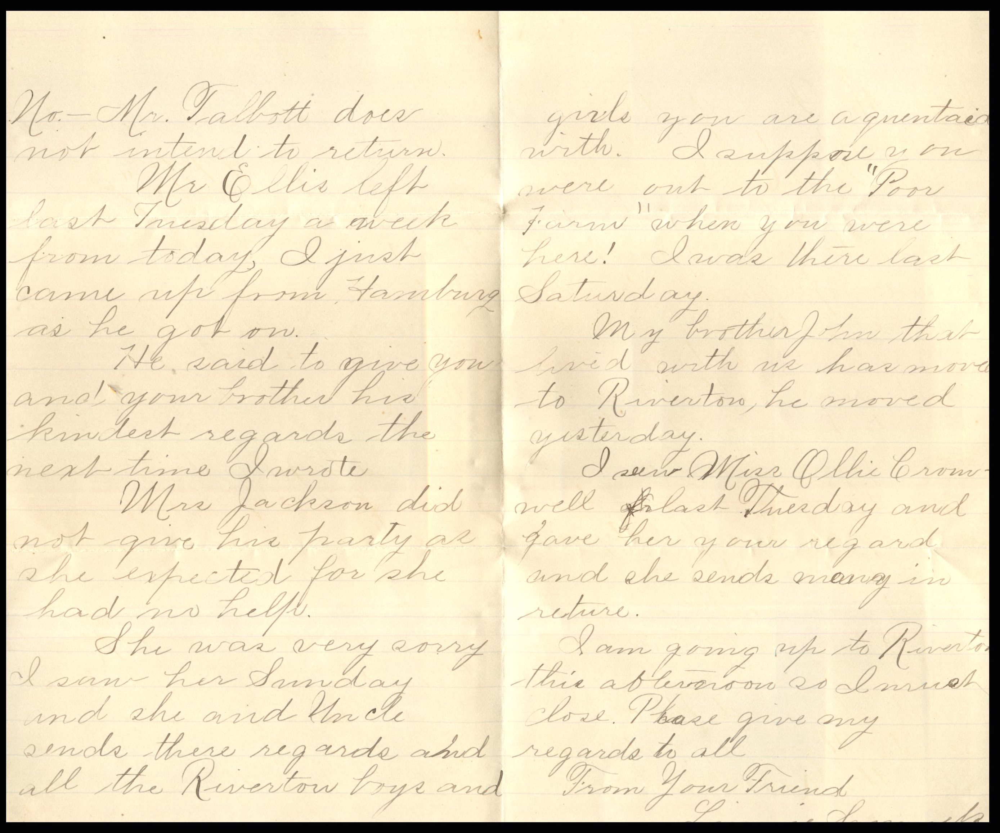
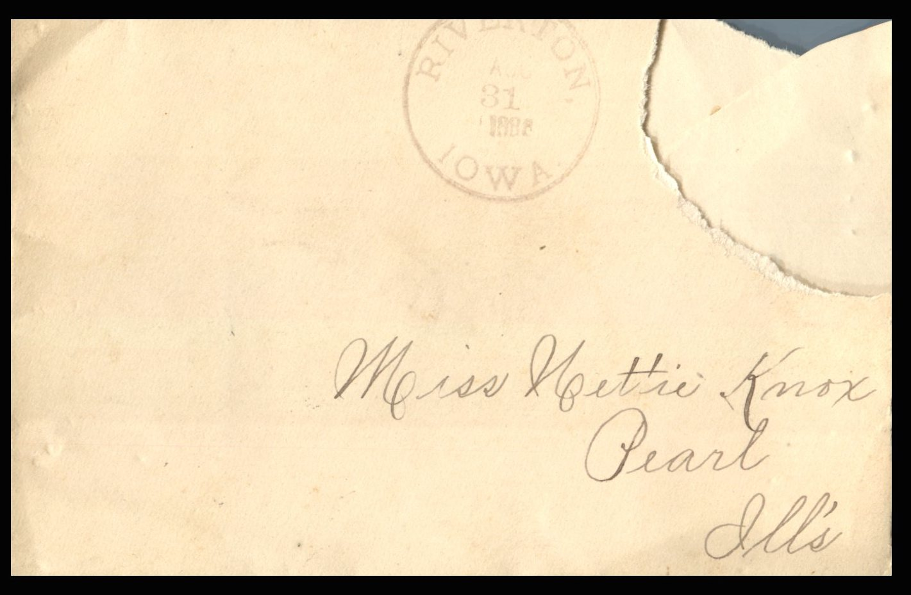

  From: Linnie Samuels, To: Jeanette Knox Chandler  
Mailed From: Riverton, Iowa on August 31, 1885

Miss Nettie Kox  
Pearl, Illinois

Riverton, Iowa  
Aug 31st 1885  
Miss Nettie Knox  
My Dear Friend,  
I received your welcome letter some days ago and I have been over to Sidney the past few days and so I have not had any time to write since I came home.  
No. – Mr. Talbot does not intent to return.  
Mr. Ellis left last Tuesday, a week from today, I just came up from Hamburg as he got on.  
He said to give you and your brother his kindest regards the next time I wrote.  
Mrs. Jackson did not give his party as she expected for she had no help.  
She was very sorry I saw he Sunday and she and Uncle sends their regards and all the Riverton boys and girls you are acquainted with. I suppose you were out to the “Poor Farm” when you were here! I was there last Saturday  
My brother John that lived with us has moved to Riverton, he moved yesterday.  
I saw Miss Ellie Cromwell last Thursday and gave her your regards and she sends many in return.  
I am going up to Riverton this afternoon so I must close. Please give my regards to all.  
From Your Friend,  
Linnie Samuels