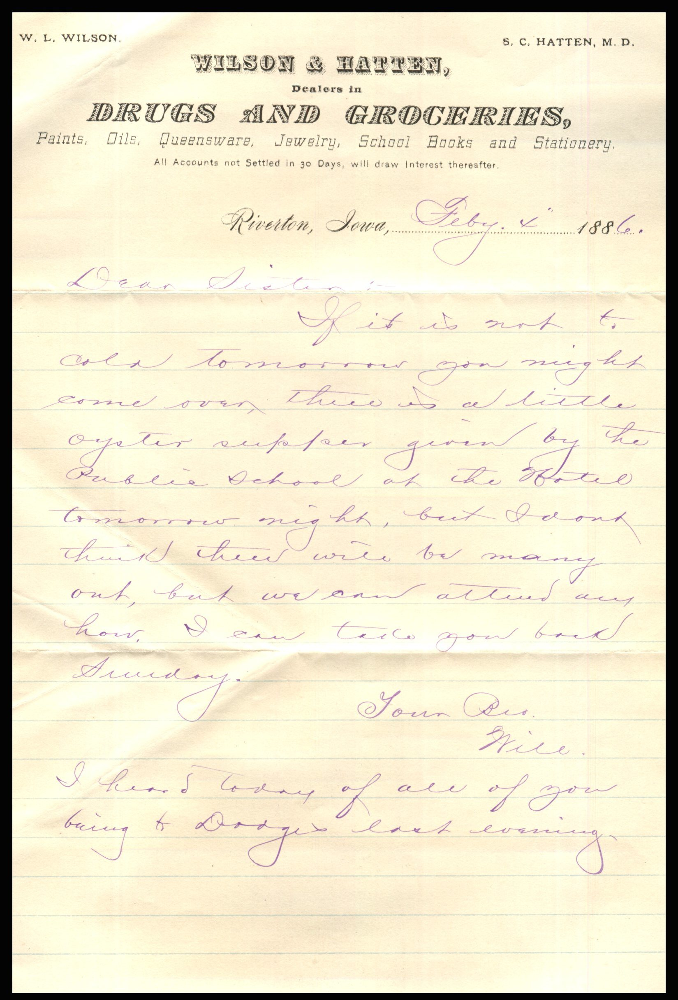
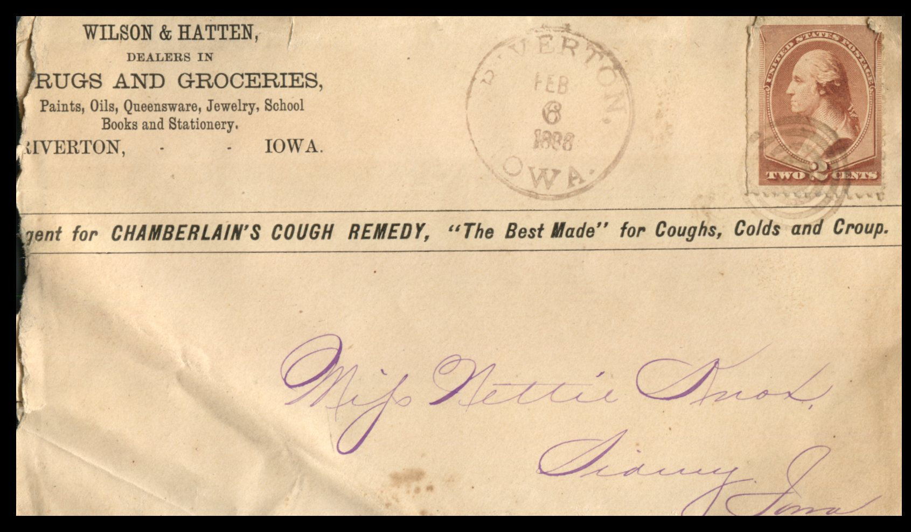

 From: William Knox , To: Jeanette Knox Chandler  
Mailed From: Riverton, Iowa on February 4, 1886

Miss Nettie Knox  
Sidney, Iowa

Wilson &amp; hatten,  
Dealers in  
Drugs and Groceries  
aints, Oils, Queensware, Jewelry, School Books and Stationary.  
All Accounts not Settled in 30 Days, will draw interest thereafter.  
Riverton, iowa, Feb. 4th, 1886  
Dear Sister,  
If it is not to cold tomorrow you might come over, there is a little oyster supper given by the public school at the Hotel tomorrow night, but I don’t think there will be many out, but we can attend anyhow. I can take you back Sunday.  
Your Bro,  
Will  
I heard today of all of you being to Dodge’s last evening.