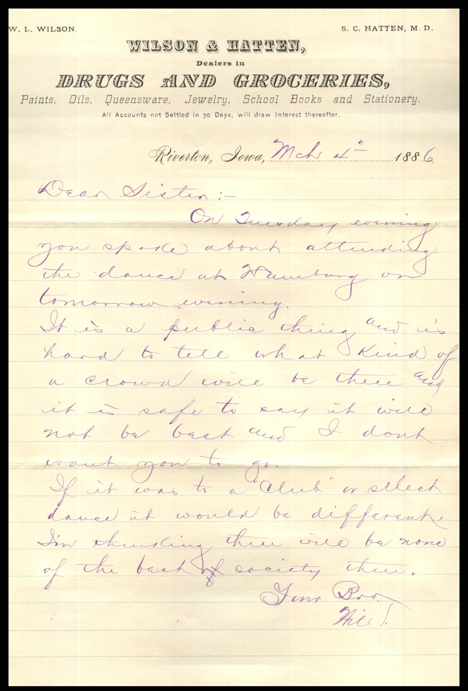
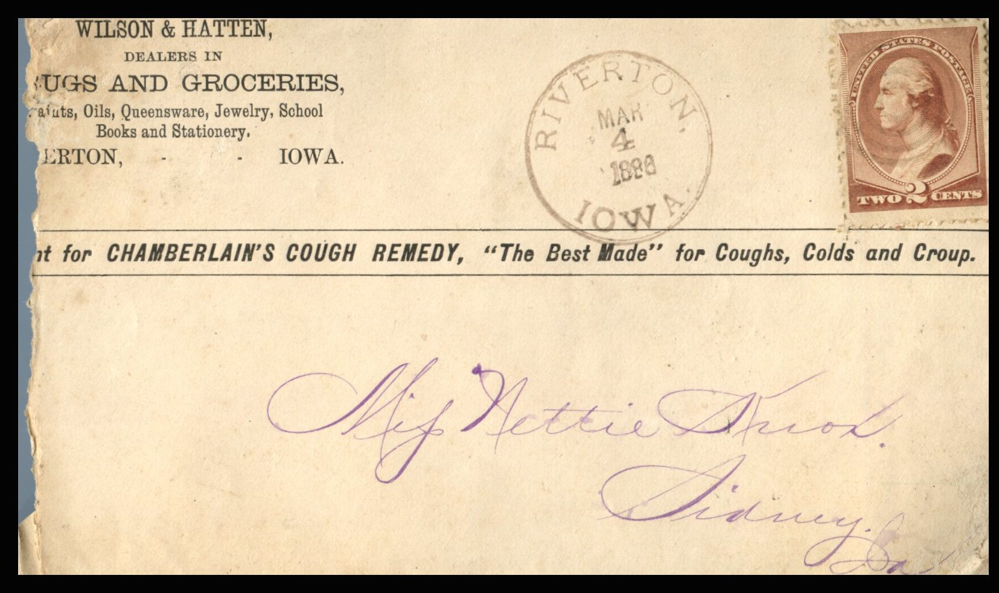

 From: William Knox, To: Jeanette Knox Chandler  
Mailed From: Riverton, Iowa on March 4, 1886

Miss Nettie Knox  
Sidney, Iowa

Riverton, Iowa, March 4th 1886  
Dear Sister,  
On Tuesday evening you spoke about attending the dance at Hanburg on tomorrow evening.  
It is a public thing and is hard to tell what kind of crowd will be there and it is safe to say it will not be best and I don’t want you to go.  
If it was to a “club” or select dance it would be different. I’m thinking there will be none of the best of society there.  
Your Bro,  
Will K.