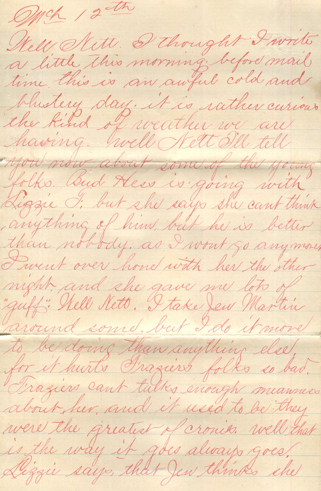
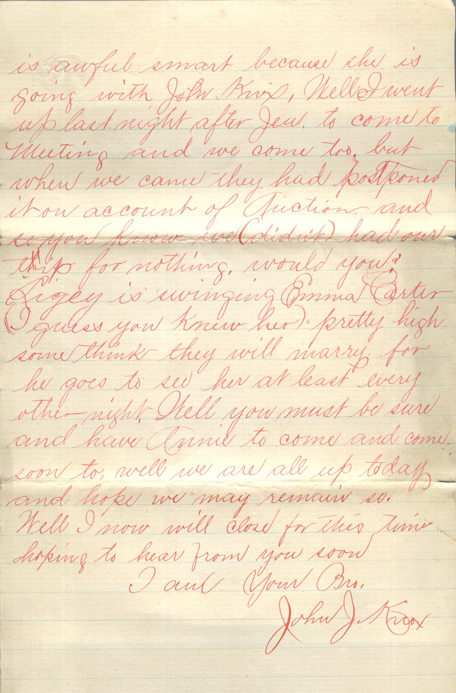

 

From: John Knox, To: Jeanette Knox Chandler  
Mailed on March 12, 1886

Mch 12th  
Well Nett. I thought I write a little this morning before mail time this is an awful cold and blustery day. It is rather curious the kind of weather we are having. Well Nett I’ll tell you now about some of the young olfks. Budd Hess is going with Lizzie F but she says she can’t think anything of him, but he is better than nobody. As I wont go any more, I went over home with her the other night and she gave me lots of “guff.” Well Nett, I take Jen Martin around some, but I do it more to be doing than anything else for it hurts Frazier’s folks so bad. Frazier’s can’t talk enough meanness about her, and it used to be they were the greatest of cronies. Well that is the way it always goes. Lizzie says that Jen thinks she is awful smart because she is going with John Knox. Well I went up last night after Jen to comes to meeting and we come too, but when we came they had postponed it on account of Auction and so you know we didnt had our trip for sighing, would you? Digey is swinging Emma Carter (I guess you new her) pretty high some think they will marry for he goes to see her at least every other night. Well you must be sure and have Annie to come and come soon too. Well we are all up today and hope we may remain so. Well I now ill close for this time. Hoping to hear from you soon.  
I am Your Bro,  
John H. Knox