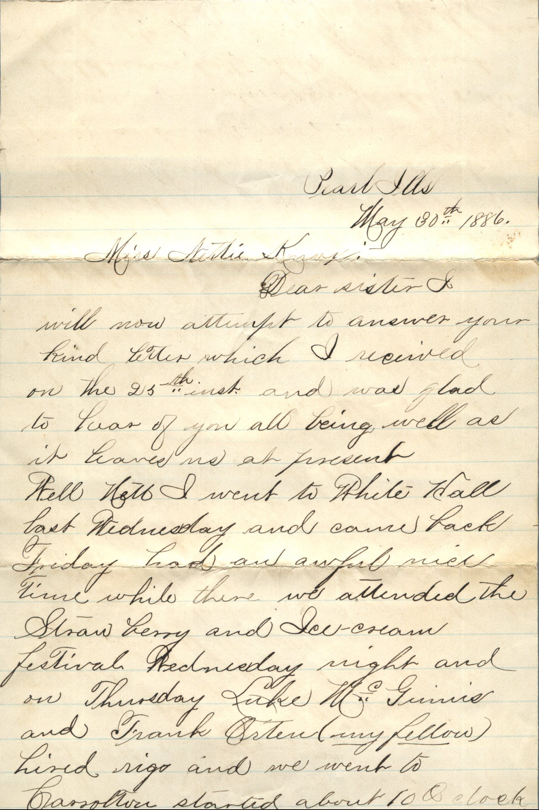
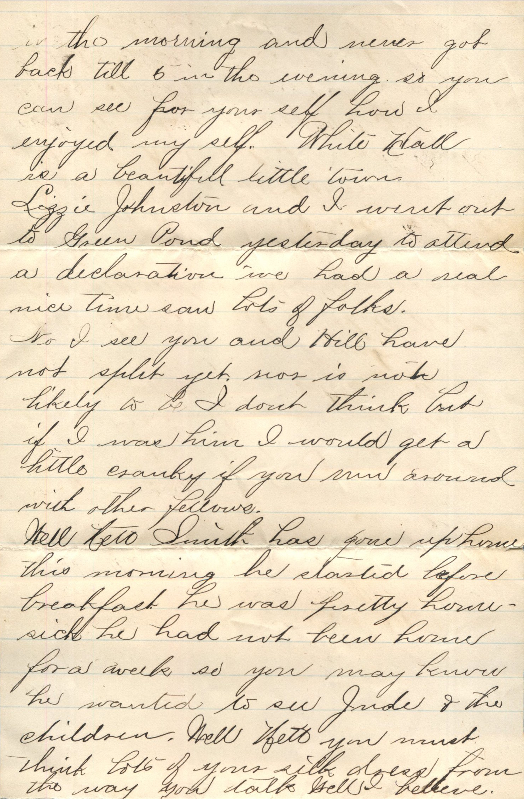
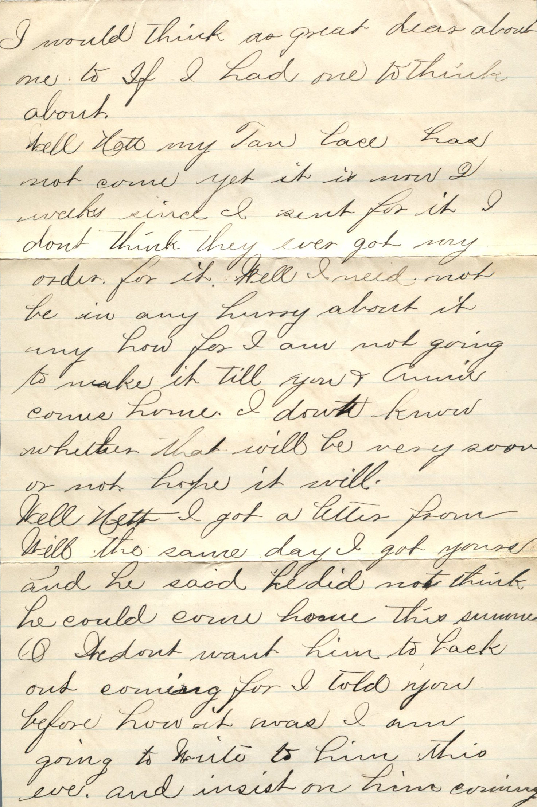
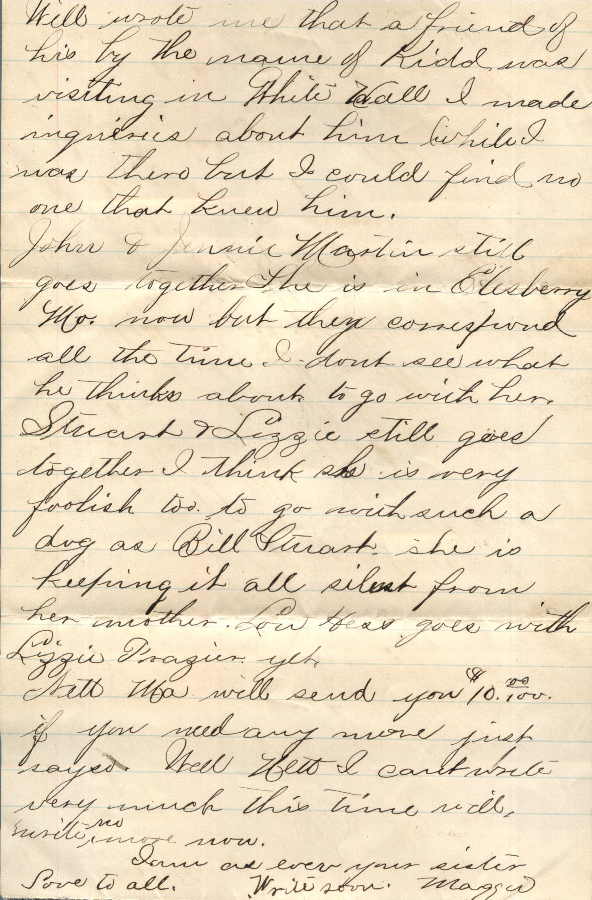
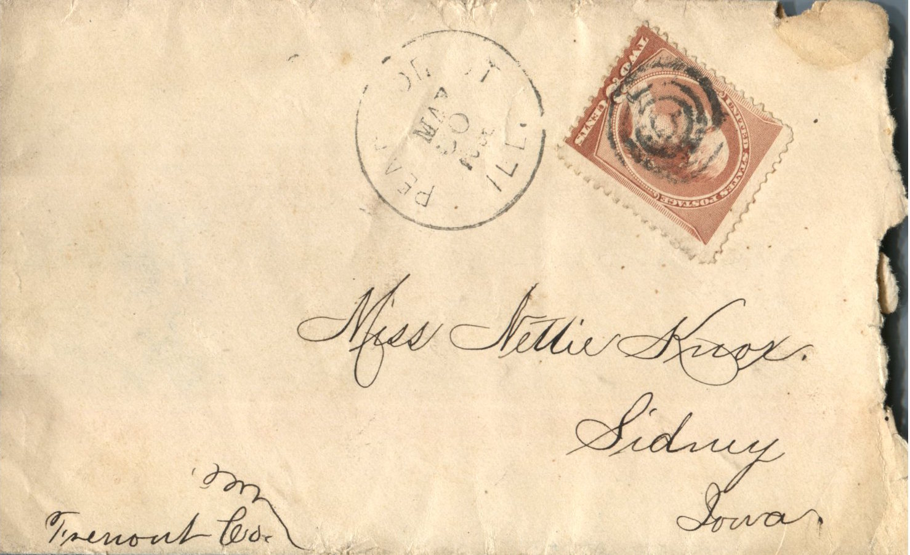

    

From: Maggie Knox, To: Jeanette Knox Chandler  
Mailed From: Pearl, Illinois on May 30, 1886

Miss Nettie Knox  
Sidney, Iowa

Pearl, Ills  
May 30th 1886  
Miss Nettie Knox  
Dear Sister,  
I will now attempt to answer your kids letter which I received on the 25th and was glad to learn of you all being well as it leaves us at present.  
Well Nett I went to White Hall last Wednesday and came back Friday. Had an awful nice time while there. We attended the Strawberry and Ice Cream Festival Wednesday night and on Thursday, Luke Mc Junior and Frank Orten (my fellow) hired rigs and we went to Carrolton started about 10 o’clock in the morning and never got back till 5 in the evening so you can see for yourself how I enjoyed myself. White Hall is a beautiful little town. Lizzie Johnston and I went out to Green Pond yesterday to attend a declaration. I’ve had a real nice time, saw lots of folks. No I see you and Hill have not split yet. Nor is not likely to be. I don’t think but if I was him I would get a little cranky if you run around with other fellows.  
Well Nett Smith has gone up home this morning. He started before breakfast. He was pretty home sick. He had not been home for a week so you may know he wanted to see Ande and the children. Well Nett you must think lots of your silk dress from the way you talk. Well I believe. I would think as you great dear about me to think about.  
Well Nett my tan lace has not come yet it is now 1 week since eI sent for it. I don’t think they ever got my order for it. Well I need not be in any hurry about it any how for I am not going to make it till you and Annie comes home. I don’t know whether that will be very soon or not. Hope it will.  
Well Nett I got a letter from Will the same say I got yours and he said he did not think he could come home this summer. Oh I don;t want I’m to back out coming for I told you before how it was I am going to write to him this eve and insist on him coming. Will wrote me that a friend of his by the name of Kidd was visiting in White Hall. I made inquiries about him while I was there but I could find no one that knew him.  
John and Jennie Martin still goes together. She is in Elesberry, Mo. now but they correspond all the time. I don’t see what he thinks about to go with her. Stuart and Lizzie still goes together I think she is very foolish too to go with such a dog as Bill Stuart. She is keeping it all silent from her mother. Lou Hess goes with Lizzie Frazier yet.  
Nett, Ma will send you $10.00 if you need any more just say. Well Nett I can’t write very much this time, so I’ll write no more now.  
I am as ever your sister  
Write soon,  
Maggie  
Love to all