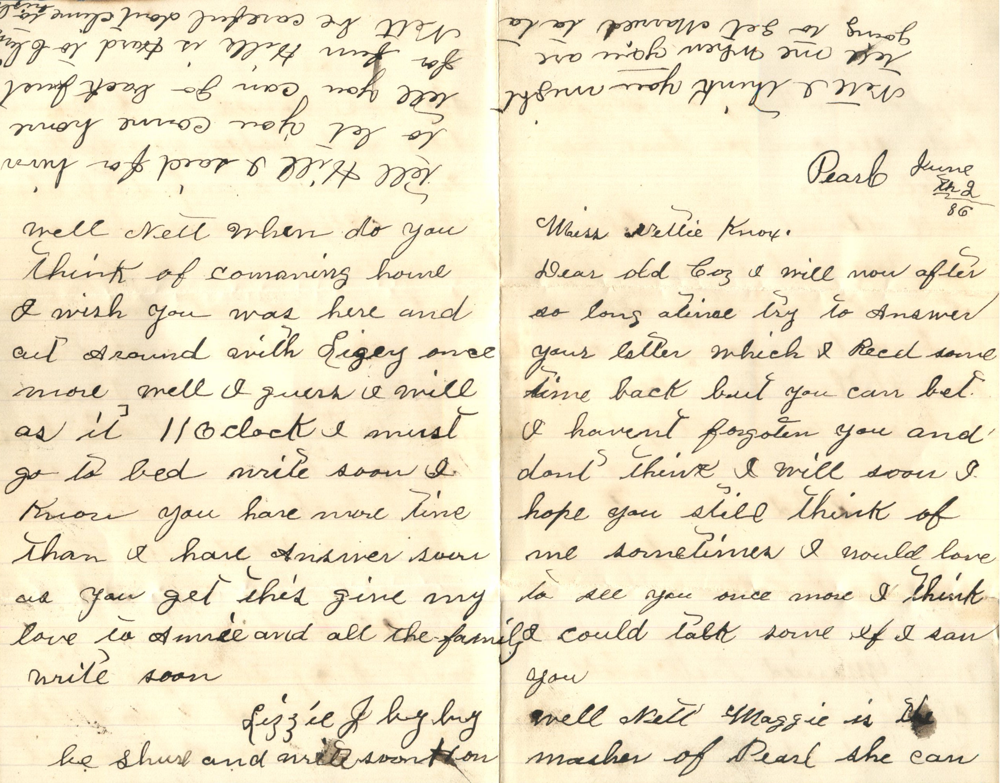
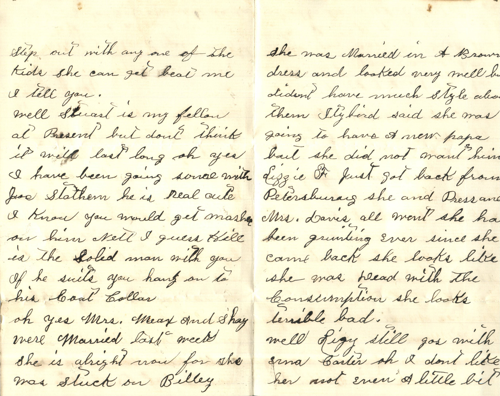
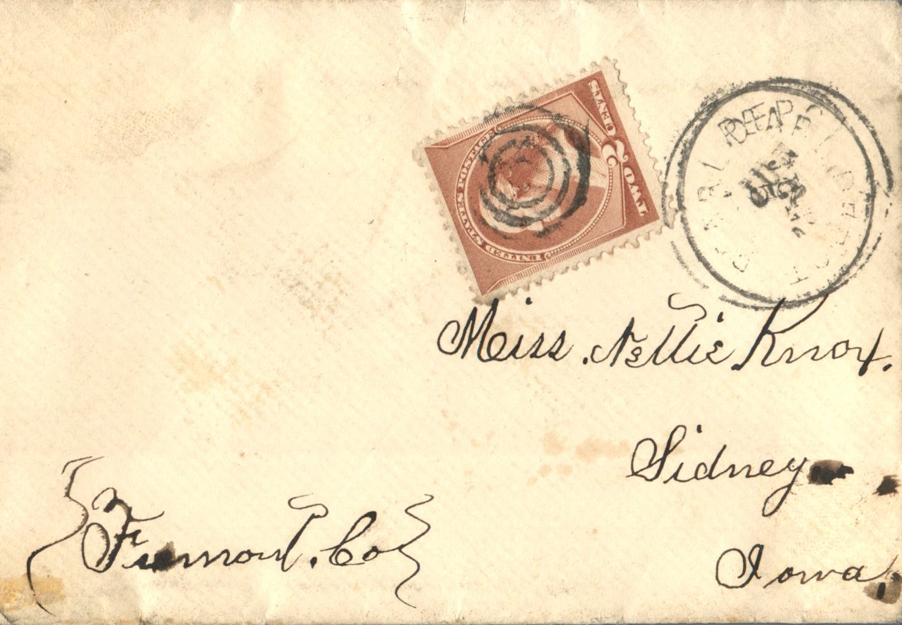

  

From: Lizzie J, To: Jeanette Knox Chandler  
Mailed From: Pearl, Ill on June 2, 1886

Miss Nettie Knox  
Sidney, Iowa  
Fremont Co.

Pearl, June the 2 ’86  
Miss Nettie Knox,  
Dear old toy, I will now after so long alive try to answer your letter which I received some time back but you can bet I haven’t forgotten you and don’t think I will soon. I hope you still think of me sometimes. I would love to see you once more I think I could talk some if I saw you.  
Well Nett, Maggie is the mash of Pearl. She can step out with any one of the kids she can get beat me I tell you.  
Well Stuart is my fellow at present but don’t think it will last long. Oh yes I have been going some with Joe Stathen. He is real cute, I know you would get mash on him. Nett I guess Hill is the solid man with you. If he suits you hang on to his coat collar.  
Oh yes Mrs. Marx and Shay were married last week. She is alright now for she was stuck on Billey. She was married in a brown dress and looked very well but didn’t have much style about them. Stybird said she was going to have a new papa but she did not want him. Lizze F just got back from Petersburg. She and Press and Mrs. Davis all went. She has been grunting ever since she came back. She looks like she was dead with the consumption. She looks horrible bad.  
Well Ligey still goes with Emma Carter. Oh I don’t like her not even a little bit. Well Nett when do you think of coming home. I wish you was here and out around with Ligey once more. Well I guess I will end as it is 11 o’clock. I must go to bed. Write soon. I know you have more time than I have. Answer soon as you get this. Give my love to Annie and all the fam. Write soon.  
Lizzie J.  
Be sure and write soon hun.  
Tell Hill I said for him to let you come home till you can go back just for fun. Hill is hard to climb. Nett be careful don’t clime to high. Nett I think you might tell me when you are going to get married.