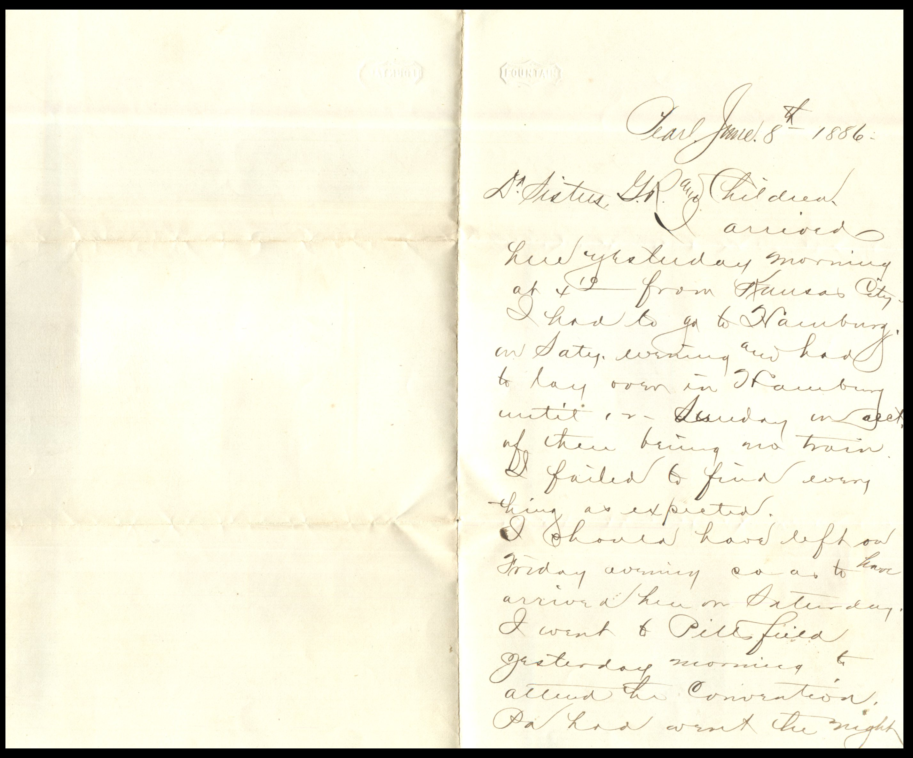
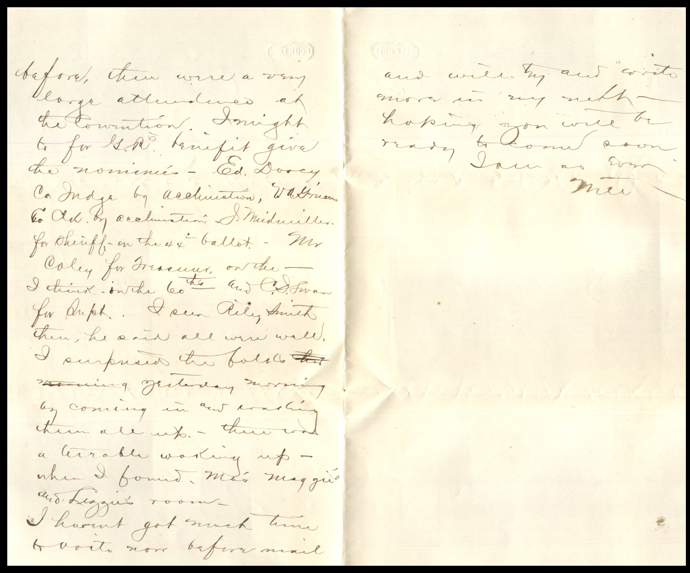
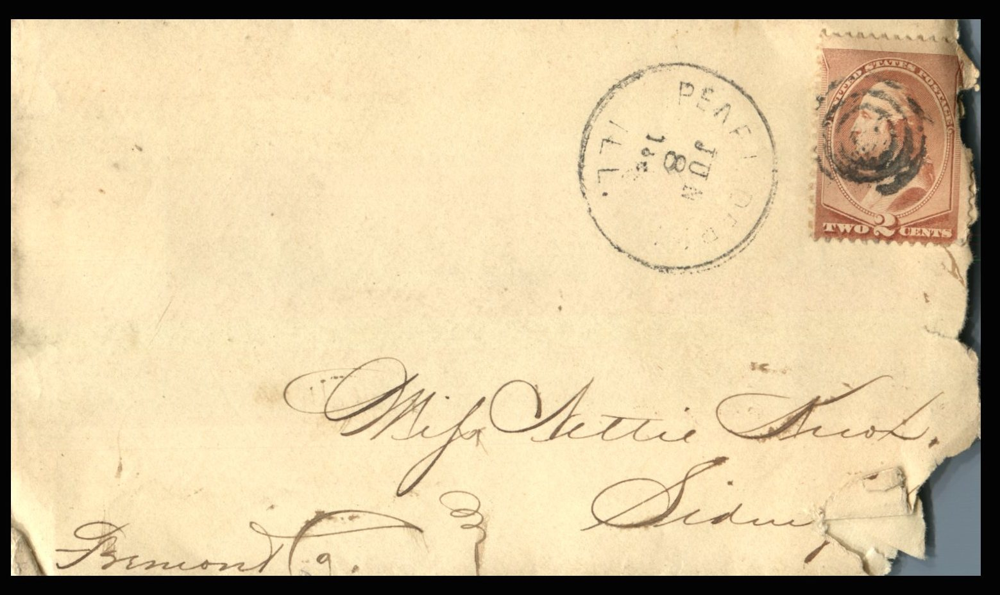

  From: Will, To: Jeanette Knox Chandler  
Mailed From: Pearl, Illinois on June 8, 1886

Mrs. Nettie Knox  
Sidney, Iowa  
Freemont Co.

Pearl, June 8th 1886  
Dear Sisters, G.R., and Children  
I arrived here yesterday morning at 4:10 from Kansas City. I had to go to Hainburg on Saturday morning and has to lay over in Hainburg until Sunday on account of there being no train. I failed to find everything as expected.  
I should have left on Friday evening so as to have arrived here on Saturday. I went to Pittsfield yesterday morning to attend the convention. Pa had went the night before. There were a very large attendance at the Convention. It might be fore G.R.’s benefit give the nominees. Ed. Dorcy Ca Judge by acclimation, VA Gruos by acclimation. K. Midvilleton for sheriff in the 44th ballot. Mr. Coley for Treasurer I think on the 60th and C.J. Swan for Dept. I seen Riley Smith ten, he said all were well. I am surprised he followed yesterday morning by coming in and working them all up. Then he kept working while I found Maggie and Lizzie room.  
I haven’t got much time to write now before mail and will try and write more in my next. Hoping you will be ready to come soon.  
Love to all,  
Will