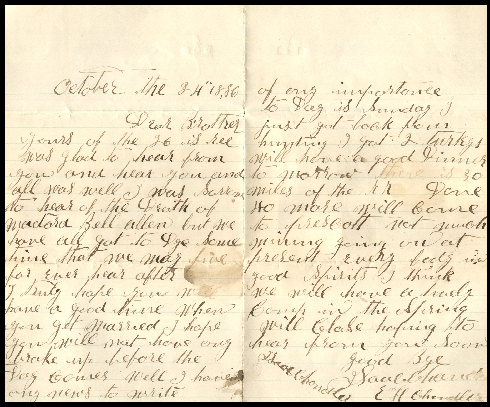

From: Elijah H., Dave, and J. Saul Chandler, To: Unknown Chandler  
Mailed On: October 24, 1886

October the 24, 1886  
Dear Brother,  
Yours of the 26 is received. Was glad to hear from you and hear you and all was well. I was sorry to hear of the Death of Mactard Bell Allen but we have all got to Dye some time. That we may be fine forever here after. I truly hope you will have a good time when you get married. I hope you will not have any brake up before the day comes. Well I have some news to write of any importance.  
Today is Sunday I just got back from hunting. I got 2 turkeys. Will have a good dinner tomorrow. There is 30 miles of the R.R. done. 40 more will come to precut. Not much mining going on at present. Everybody in good spirit. I think we will have a break in the spring. Will close hopping to hear from you soon.  
Goodbye,  
J. Saul Chandler  
E.H. Chandler  
Dave Chandler