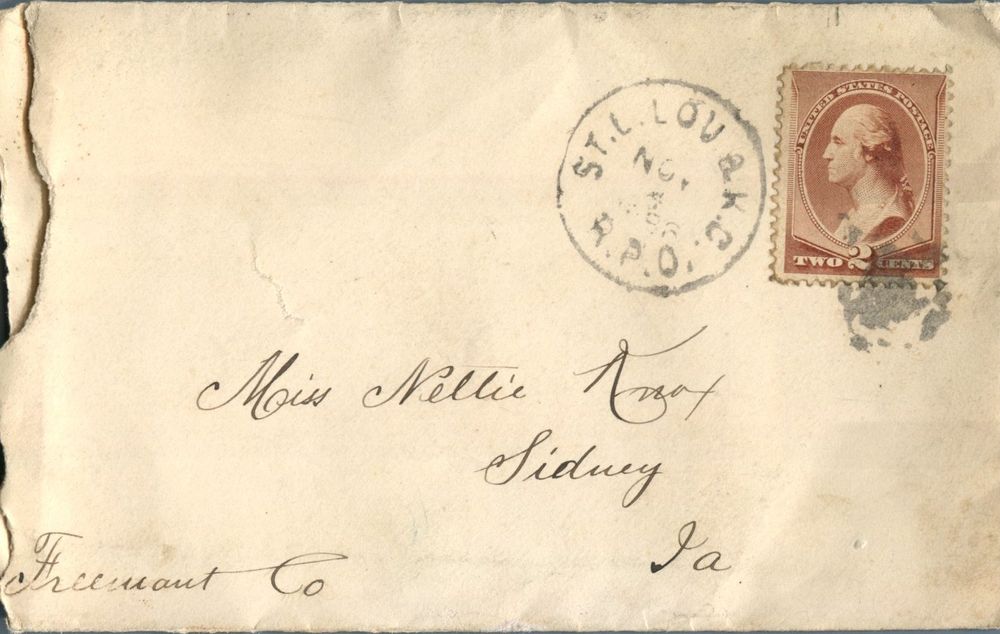

 [F](http://107.170.91.122/wp-content/uploads/2014/04/postcard-2014-20140416_17143721_0011.jpg)rom: Elijah H. Chandler, To: Jeanette Knox Chandler  
Mailed From: St. Lovack, R.P.O on November3, 1886

Miss Nettie Knox  
Sidney, Ia  
Freenaut Co

Peace Holy November 3rd ’86  
Dear Nettie,  
I will not try and answer your kind letter that I received today. I had been looking for a letter two or three days. I should have written to you yesterday only I knew I had 2 or 3 letters that were not answered yet and thought I would wait one day more. The Methodist are holding a protected meeting now. I have been going all the time ’til tonight. Thought I would rather stay at home and write to you than to go to Church as I find more pleasure writing to you than anything else while I cannot be with you. I don’t want you to get mad about the short letter I wrote you today. I did not have time to write any. I wanted to get a letter started as soon as possible so I could hear from you again that much sooner. A week seems like a month to me when I don’t hear from you. I took a message this evening from Sidney to your Pa, when the Just Commenced Spelling Sydney. I was awful anxious to hear what it was going to be there. Was a thousand thoughts in my head. I was afraid somebody was sick. I was glad when I heard that it was about the Election. Your Pa is in Pittsfield on the grand jury. I forwarded the telegram to him at Pittsfield there. I bought a copy for our house and gave it to Maggy. She flew around the table to get it. When I told her it was from Sidney she said she would bet you was coming. Had then the thought it was from Willie. No I did not know Lizzie H. had to set up while Ian was there. They have not got any stove up yet. Ian was down last Sunday about knowing whether he stayed all night or not. Did you hear about Frageus Boby dying. It died last Friday, I think. very body has have election on the Bra for the last week. I am glad it is over now. The Eutrise Democratic ticket was elected in the county.  
Yes Nettie I wish I could have been there last Sunday night. I can’t think of any thing that would be more enjoyment for me than to be with you. I think of you every time I come to the house and many many other times. I think more of you every time I hear from you. Seems to me like because I think you mean what you say. Yes, I know you do. I don’t think you could have any object in being false. Nettie I will tell you again that I never had half as much confidence in any one as I have in you and while I have I assure you that I will never give you any room to complain. I will be awful glad when I get the hat work you are making. Wish you would come with it and fit in my hat. Do you remember the heart you sewed in my hat once. There is a big difference now, you know time. Some time changes mind but not in all cases. I know nothing will ever change my mind in regard to you. Do you remember about George Aker’s wife dying just a short time before you left. I understand he is going to get married tomorrow to May Miller. I think he is in a hurry, don’t you? I am getting cold now. I will close for tonight. Hope will hear from soon.  
Yours Truly,  
E.H. Chandler  
I wish you was here Nettie