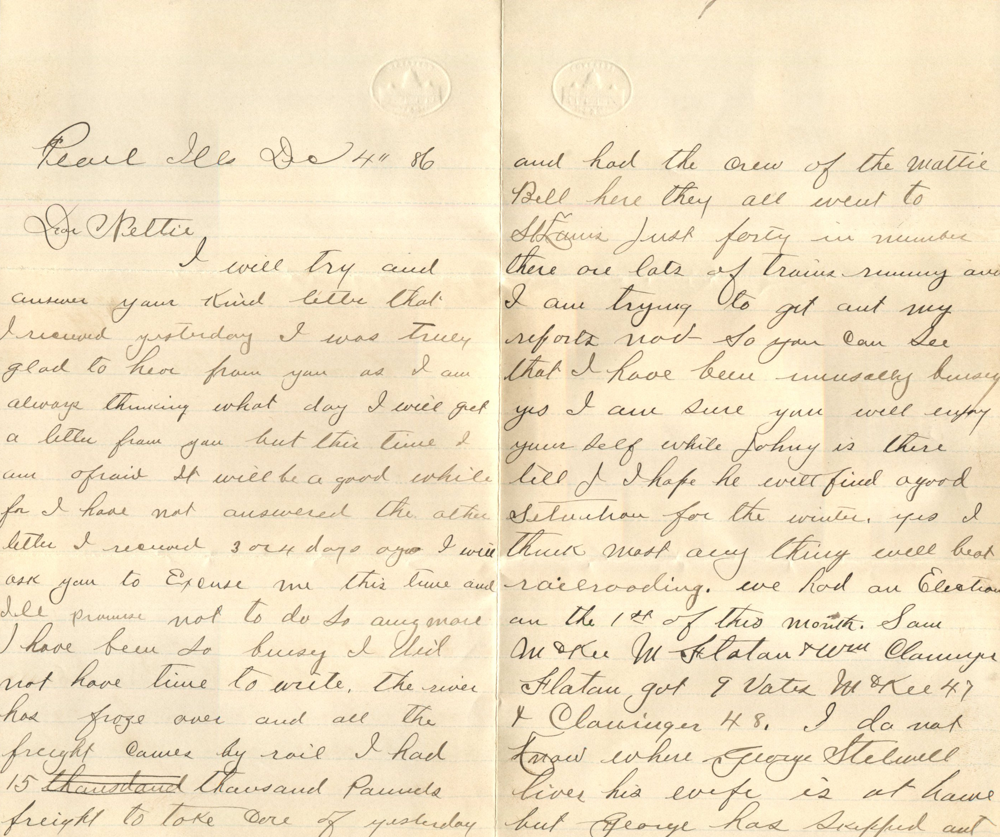
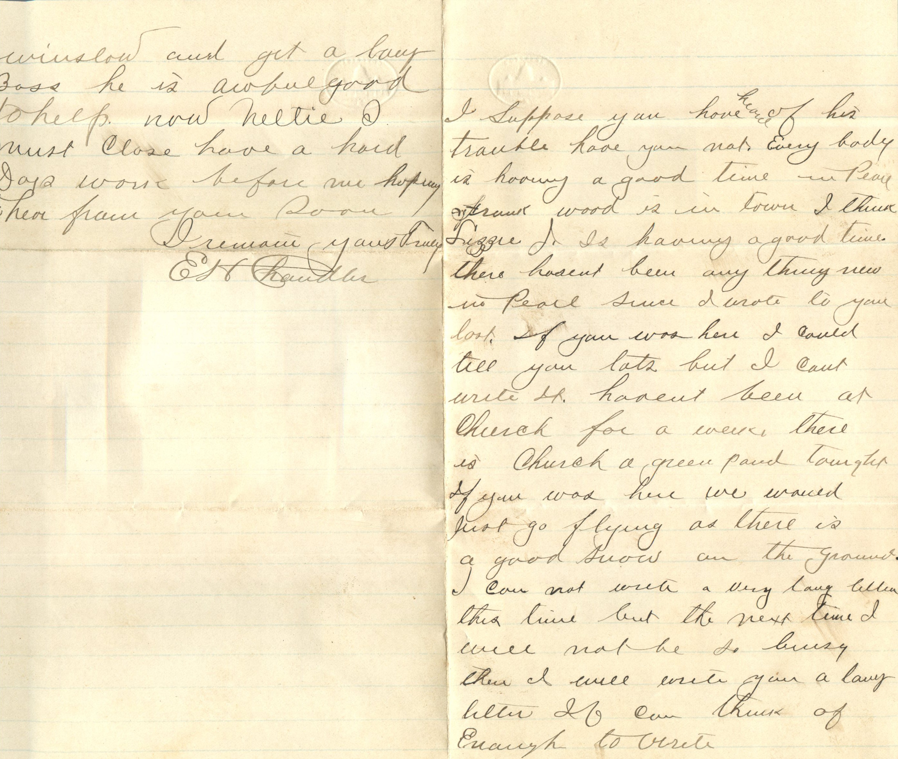
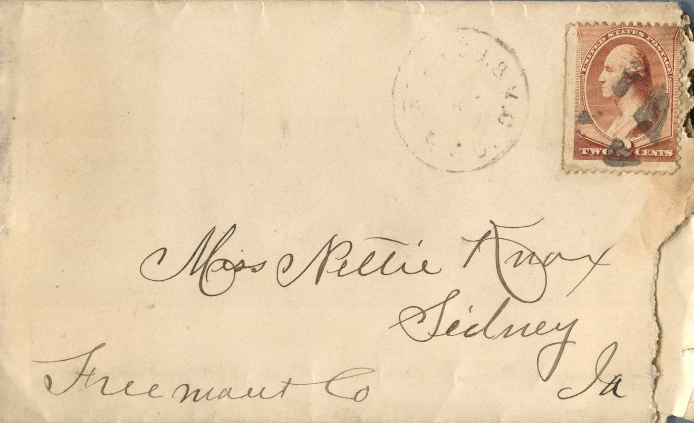

  

From: Elijah H. Chandler, To: Jeanette Knox Chandler  
Mailed From: Pearl, Illinois on December 4, 1886

Miss Nettie Knox  
Sidney, Ia  
Freemont Co.

Pearl Ill Dec 4th ’86  
Dear Nettie,  
I will try and answer your kids letter that I received yesterday. I was truly glad to hear from you as I am always thinking what day I will get a letter from you but this time I am afraid it will be a good while for I have not answered the other letter I received 3 or 4 days ago. I will ask you to excuse me this time and I’ll promise not to do so anymore. I have been so busy I did not have time to write. The river has froze over and all the freight comes by rail. I had 15 thousand pounds freight to take care of yesterday and had the crew of the Mattie Bell here. They all went to St. Louis. Just fourteen number. There are lots of trains running and I am trying to get out my reports now. So you can see that I have been usually busy. Yes I am sure you will enjoy yourself while Johny is there till I hope he will find a good situation for the winter. Yes I think most any thing will beat railroading. We had an election on the 1st of this month. Sam McKee Flatan and Will Clauinger Flatan. Got 9 Votes. McKee 47 and Clauinger 48. I do not know where George Steelewell lives. His wife is at home but George has skipped out. I suppose you have heard of his trouble have you not. Every body is having a good time in Pearl. Frank Wood is in town I think. Lizzie J is having a good time. There hasn’t been anything new in Pearl since I wrote to you last. If you was here I could tell you lots but I can’t write it. Haven’t been at church for a week. There is church, a green pond tonight if you was here we would just got flying as there is a good snow on the ground. I can not write a very long letter this time but the next time I will not be so busy then I will write you a long letter if can think of enough to write.  
Winslow and get a long bass. He is awful good to help. Now Nettie I must close. Have a hard days work before me hoping to hear from you soon.  
I Remain Yours Truly  
E.H. Chandler