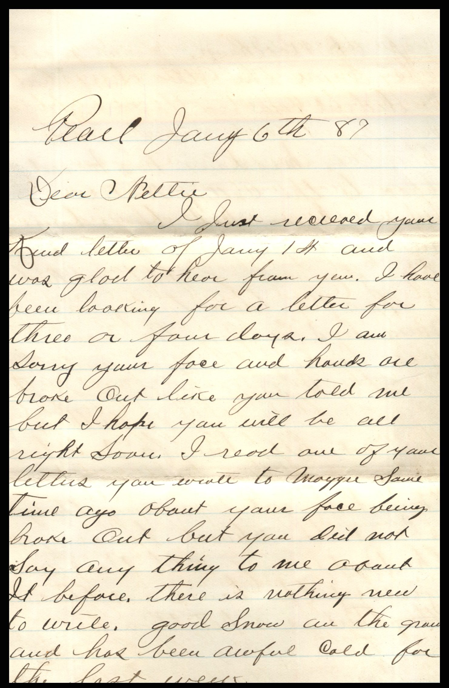
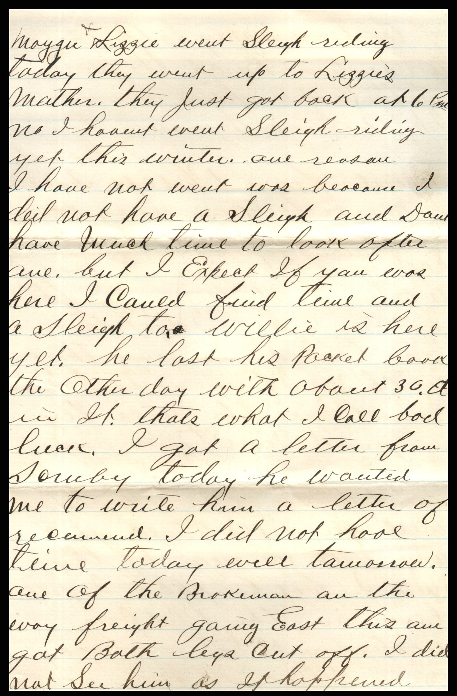
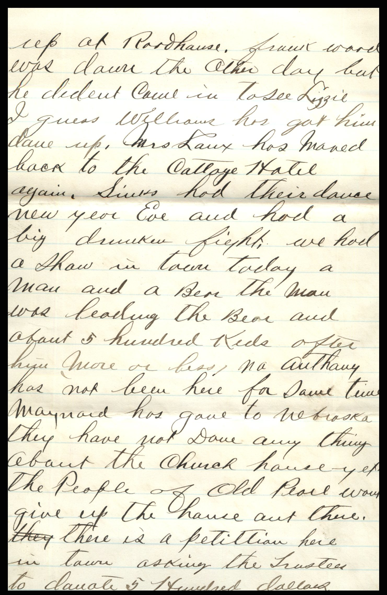
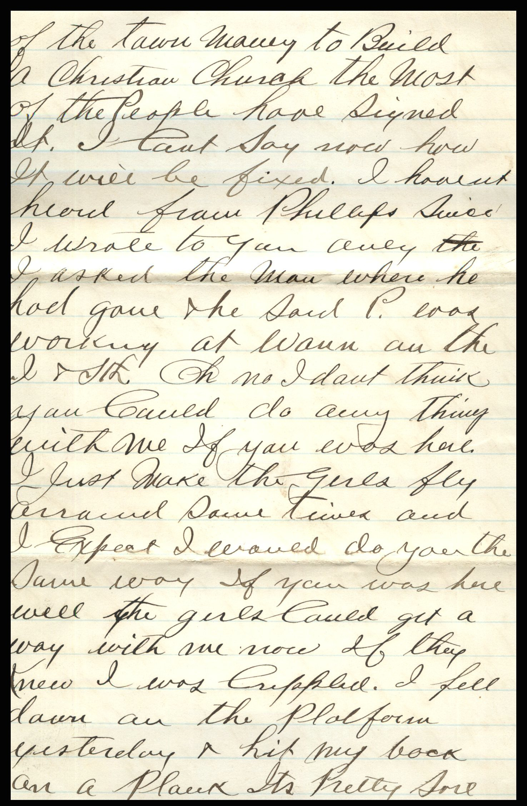
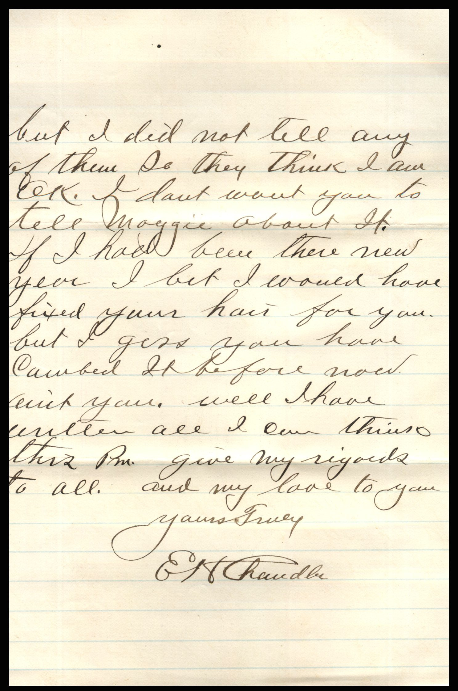
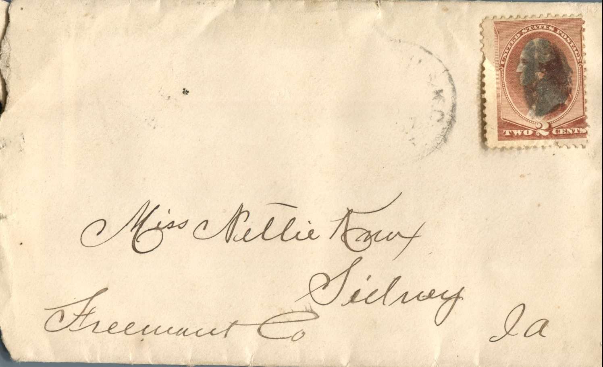

From: Elijah H. Chandler, To: Jeanette Knox Chandler

Miss Nettie Knox  
Sidney, Ia.  
Freenaut Co.

Pearl, January 6th ’87  
Dear Nettie,  
I just received your kind letter of January 1st and was glad to hear from you. I have been looking for a letter for three or four days. I am sorry your face and hands both broke out like you told me but I hope you will be all right soon. I read one of your letter you wrote to Maggie some time ago about your face being broke out but you did not say anything to me about it before. There is nothing new to write. Good snow on the ground and has been awful cold for the last week. Maggie and Lizzie went sleigh riding today. They went up to Lizzie’s mother. They just got back at 6 pm. No I haven’t been sleigh riding yet this winter. One reason I have not went was because I did not have a sleigh and don’t have such time to look after one. But I expect if you was here I could find time and a sleigh too. Willie is here yet. He lost his pocket book the other day with about 30 dollars in it. That’s what I call bad luck. I got a litter from Soruby today. He wanted me to write him a letter of recommend. I did not have time today, will tomorrow. One of the Broker men on the way freight going East this a.m. got both legs cut off. I did not see him as it happened at Roadhouse. Frank Ward was down the other day but he didn’t call in to see Lizzie. I guess William has got him done up. Mrs. Laux has moved back to the Cattoye Hatil again, Siul’s had their dance new year’s eve and had a big drunken fight. We had a show in town today. A man and a bear. The man was leading the bear and about 5 hundred kids after him more or less. No Anthany has not been here for some time. Maynard has gone to Nebraska. They have not done anything about the church house yet. The people of Old Pearl would give up the house out there. There is a petition here in town asking to the trustees to donate 5 hundred dollars of the town money to build a Christian church. The most of the people have signed it. I can’t say how it will be fixed. I haven’t heard from Phillips since I wrote to you. Only I asked the man where he had gone. He said P. was working at Waun on the I and 5th. Oh no, I don’t think you could do anything with me if you was here. I just make the girls fly around. I expect I would do you the same way if you was here. Well, the girls could get away with me now if they knew I was crippled. I fell down on the platform yesterday and hit by back on a plank. It’s pretty sore but I did not tell any of them so they think I am OK. I don’t want you to tell Maggie about it. If I had been there new year I bet I could have fixed your hair for you but I guess you have combed it before now. Well I have written all I can think of this p.m. Give my regards to all. And my love to you.  
Your’s Truly,  
E.H. Chandler