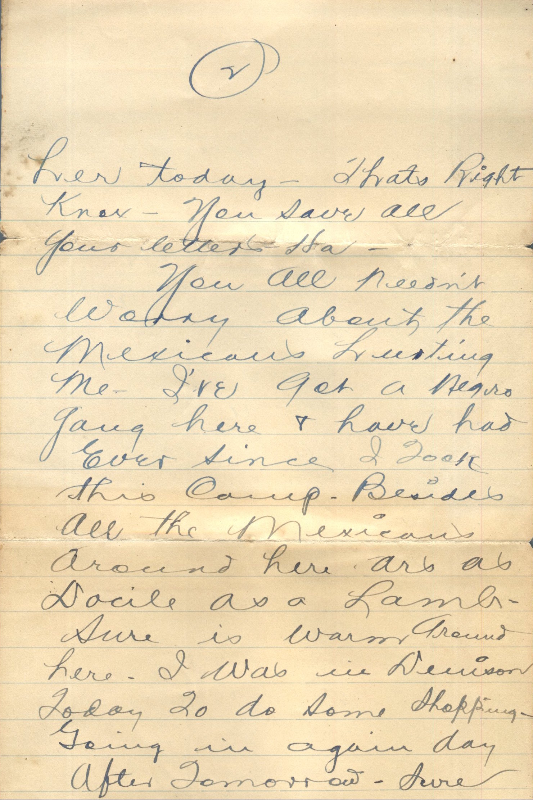
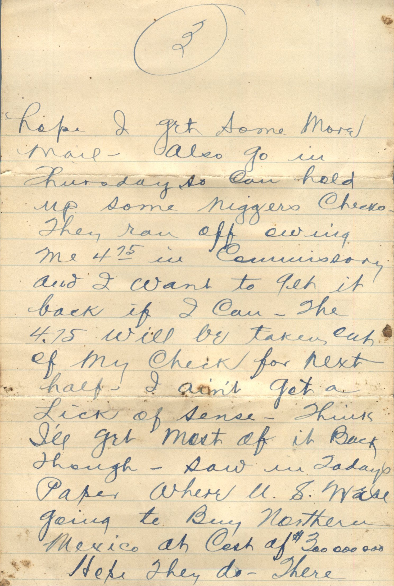
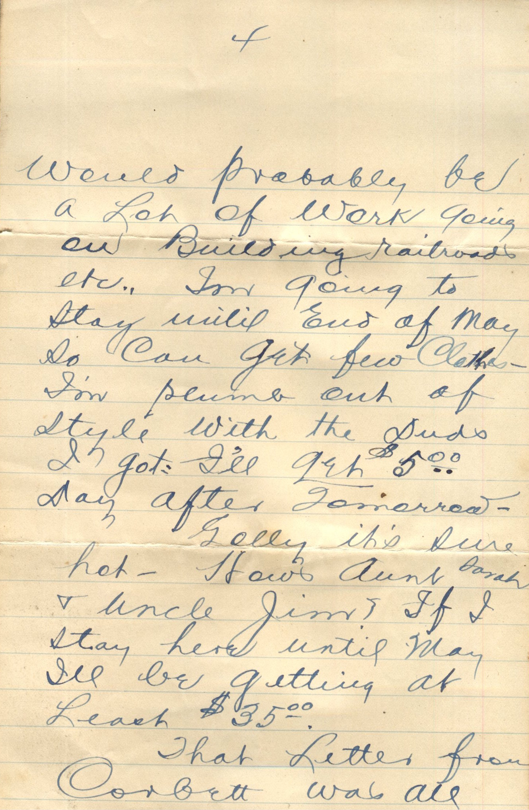
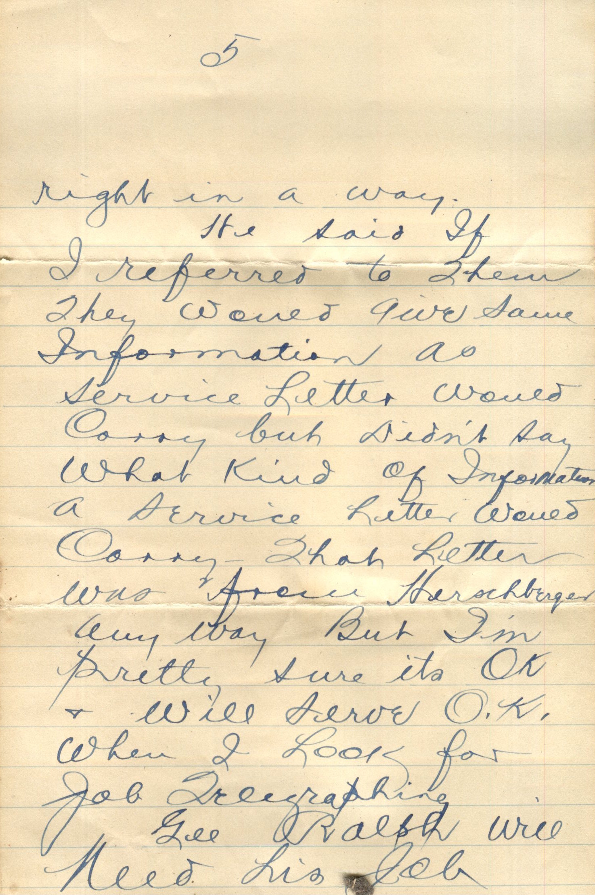
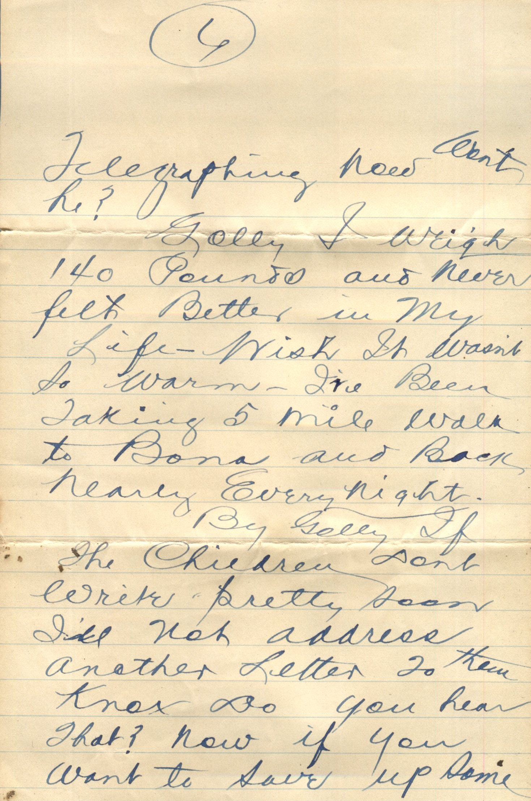
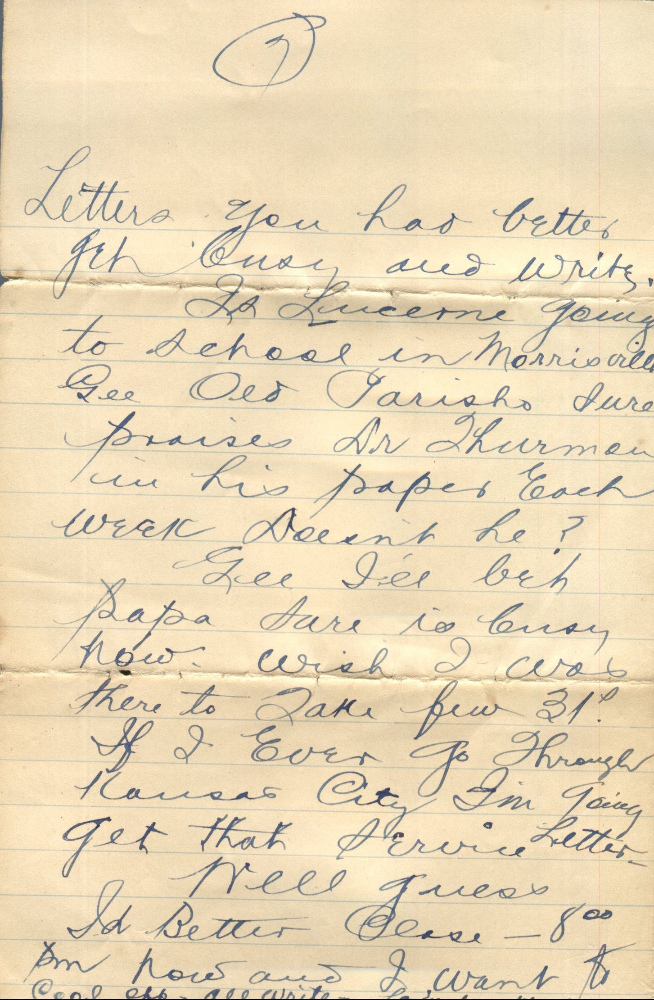

     

From: Martin Chandler, To: Unknown

Missing Page 1

Page 2:  
her today. That’s right Knox. You save all your letters-Ha.  
You all needn’t worry about the Mexicans hurting me. I’ve got a Negro gang here and have had ever since I took this camp. Besides all the Mexicans around here are all docile as a lamb. Sure is warm around here. I was in Denison today to do some shopping. Going in again day after tomorrow. Sure hope I get some more mail. Also go in Thursday, so can hold up some niggers checks. They ran off owing me $4.75 in commissary and I want to get it back if I can. The $4.75 will be taken out of my check for next half. I aint get a lick of sense. Think I’ll get most of it back though. Saw in today’s paper where U.S. was going to buy northern Mexico at cost of $300,000,000.  
Hope they do – There would probably be a lot of work going on, building railroads, etc. I’m going to stay until end of May so can get few clothes. I’m plume out of style with the duds I’ve got. I’ll get $5.00 day after tomorrow.  
Golly it’s sure hot. How’s Aunt Sarah and Uncle Jim? If I stay here until May I’ll be getting at least $35.00.  
That letter from Corbett was all right in a way.  
He said if I referred to them they would give same information as service letter would carry but didn’t say what kind of information a service letter would carry. That letter was from Herschberger anyway but I’m pretty sure it’s OK and will serve OK. when I look for job telegraphing.  
Gee Ralph will need his job telegraphing now wont he?  
Golly I weigh 140 pounds and never felt better in my life. Wish it wasn’t so warm. I’ve been taking 5 mile walk to Bona and back nearly every night.  
By Golly if the children don’t write pretty soon I’ll not address another letter to them. Knox do you hear that? Now if you want to save up some letters you had better get busy and write.  
Is Lucerne going to school in Morrisonville. Gee old Parish sure praises Dr. Thurmon in his paper each week doesn’t he?  
Gee I’ll bet Papa sure is busy now. Wish I was there to take few 31st. If I ever go through Kansas City I’m going get that service letter.  
Well guess I’d better close. 8:00 pm now and I want to cool off. All write.  
Lovingly,  
Martin