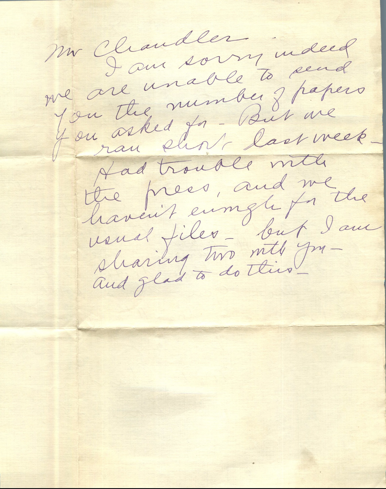
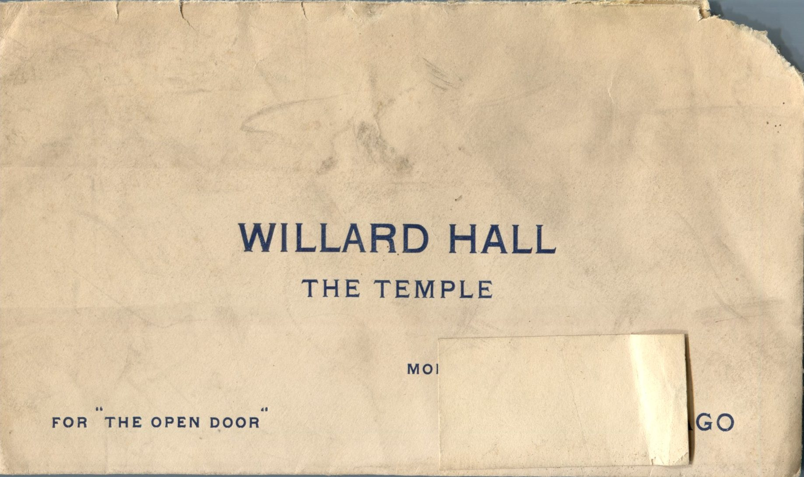

 

From: Pike County Republican, To: Martin Chandler

Mr. Chandler,  
I am sorry indeed we are unable to send you the number of papers you asked for. But we ran short last week. Had trouble with the press, and we haven’t found the usual files. But I am sharing two with you and glad to do this.