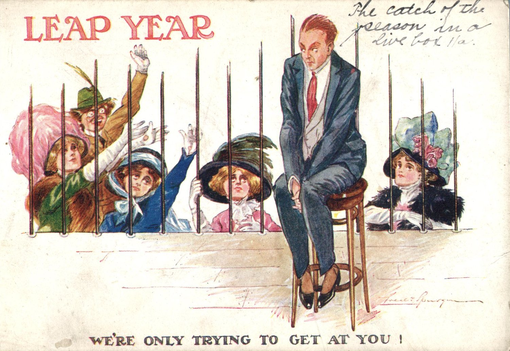
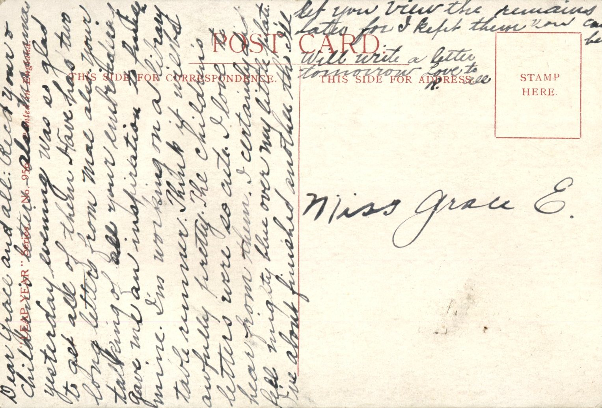

 From: Ruby Chandler, To: Grace Chandler

Miss Grace E.

Dear Grace and all  
Received you and children’s letters also Mamma’s yesterday evening. Was so glad to get all of them. Have had two long letters from Mae also your talking of all your embroideries gave me an inspiration to pursue mine. I’m working on a library table runner. Think it will be awfully pretty. The children’s letters were so cute. I love yo hear from them. I certainly feel mighty blue over my little plate. I’ve about finished another though. I’ll let you view the remains later for I kept them you can bet.  
Will write a letter tomorrow.  
Love to all,  
R.