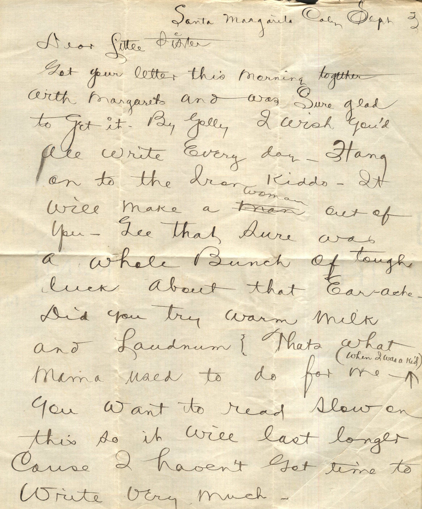
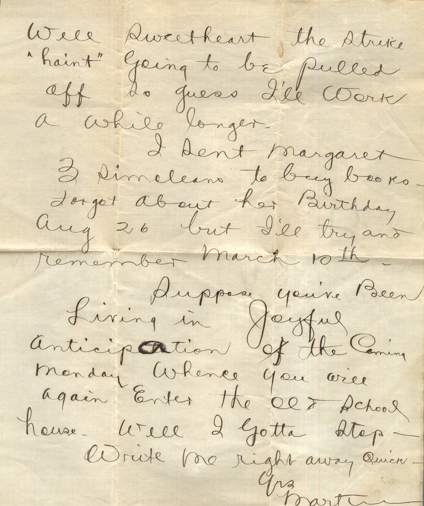

 

From: Martin Chandler, To: Unknown Female Chandler  
Mailed From: Santa Margarita, CA on September 3

Santa Margarita, CA Sept 3  
Dear Little Sister,  
Got your letter this morning together with Margaret’s and was sure glad to get it. By golly I wish you’d all write every day. Hang on to the iron kiddo. It will make a woman out of you. Gee that sure was a whole bunch of tough luck about that earache. Did you try warm milk and Laudanum? That’s what Mama used to do for me when I was a kid. You want to read slow on this so it will last longer cause I haven’t got time to write very much.  
Well sweetheart the strike “haint” going to be pulled off so guess I’ll work a while longer.  
I sent Margaret 3 Simoleans to buy books. Forgot about her birthday Aug 26 but I’ll try and remember March 10th.  
Suppose you’ve been living in joyful anticipation of the coming Monday whence you will again enter the old school house. Well I gotta stop.  
Write me right away quick,  
Yrs,  
Martin