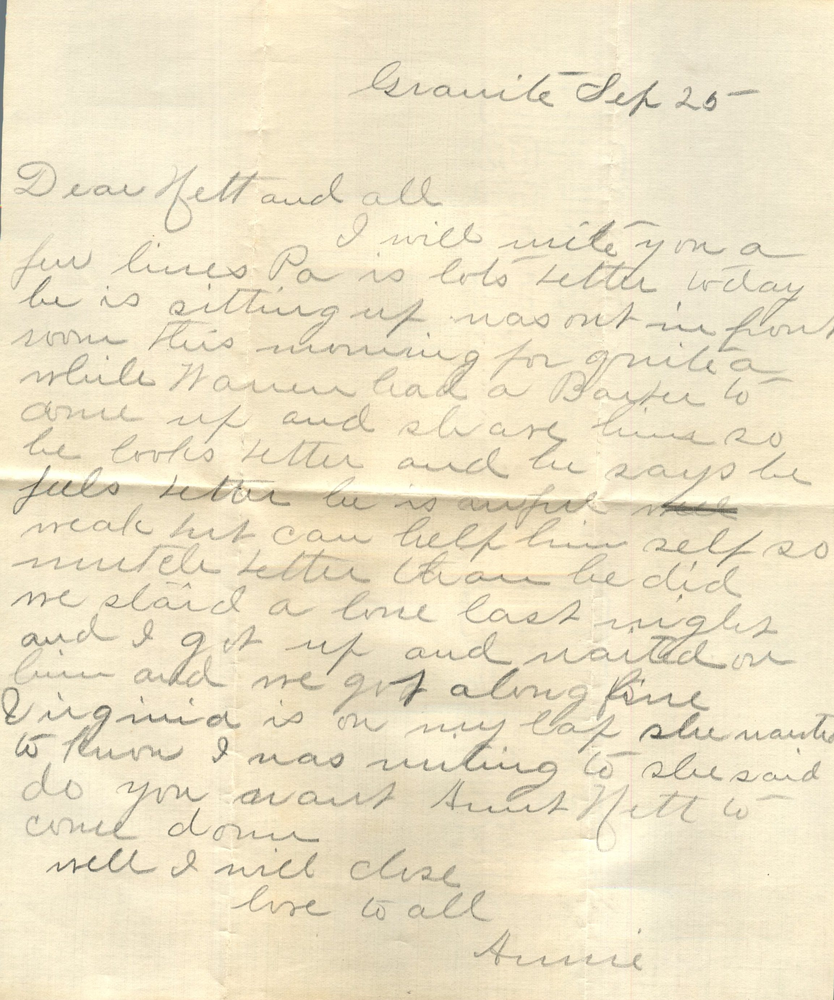

From: Annie, To: Jeanette and All  
Sent From: Granite, September 25

Dear Nett and all,  
I will write you a few lines. Pa is lots better today. He is sitting up was out in front room this morning for quite a while. Martin had a letter to answer and share him so he looks better and he says he feels better. He is awful weak but can help himself so much better than he did. He started a line last night and I got up and mailed it. Him and me get along fine. Virginia is on my lap she wanted to know who I was writing to. She said do you want Aunt Nett will come down.  
Well I will close  
Love to all,  
Annie