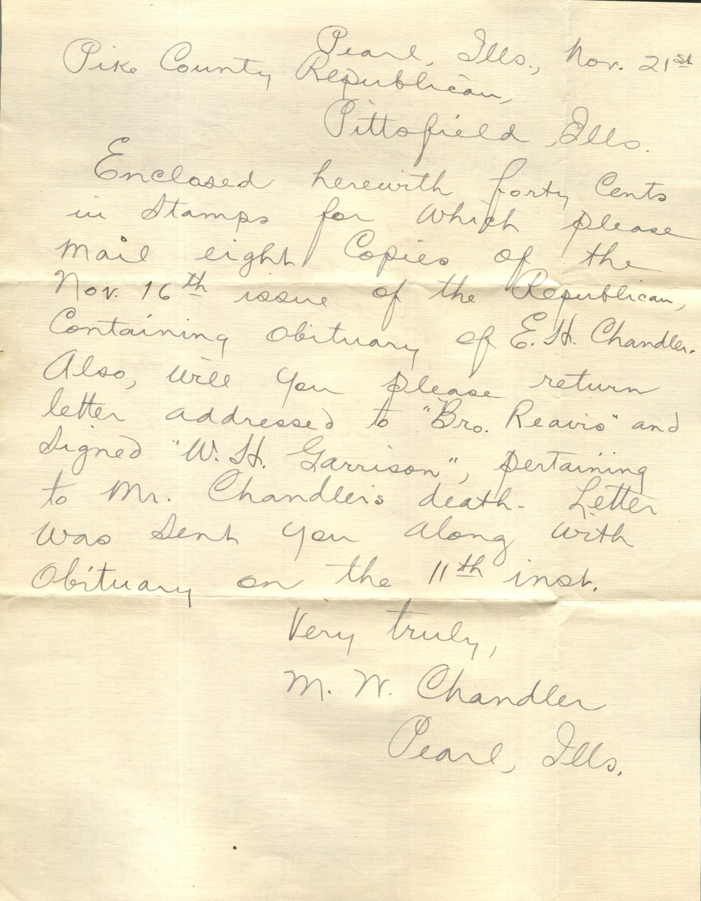
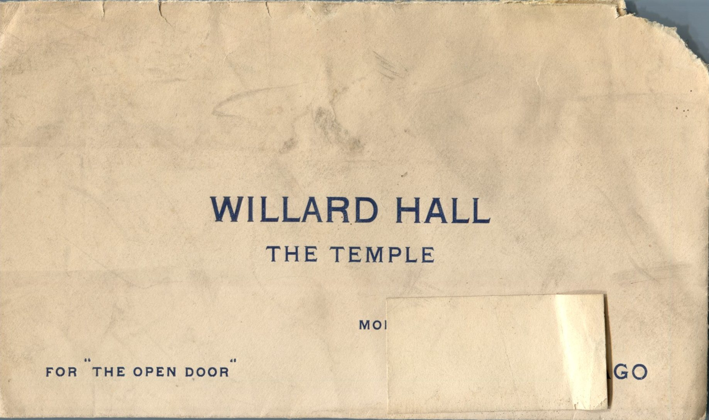

From: Martin W. Chandler, To: Pike County Republican  
Mailed From: Pearl, Illinois on November 21

Mailing Address:  
Pike County Republican  
Pittsfield, Illinois

Return Address:  
Martin Chandler  
Pearl, Illinois

Enclosed herewith forty cents in stamps for which please mail eight copies of the Nov. 16th issue of the Republican, containing obituary of E.H. Chandler. Also, will you please return letter addressed to “Bro. Reavis” and signed “W.H. Garrison” pertaining to Mr. Chandler’s death. Letter was sent to you along with obituary on the 11th inst.  
Very truly,  
M. W. Chandler  
Pearl, Illinois