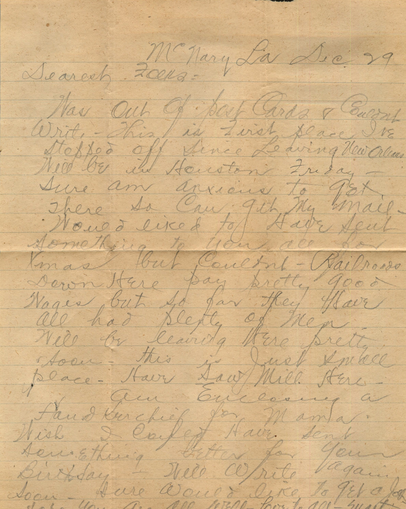
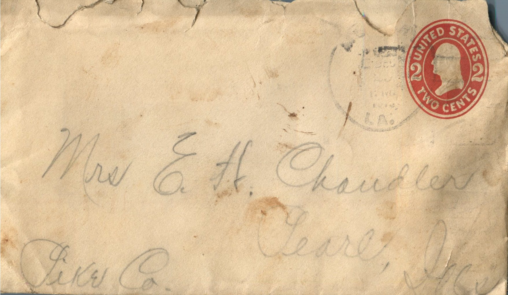

 

From: Martin Chandler, To: Elijah H. Chandler and Family  
Mailed From: McNary, LA. on December 29

Mr. E.H. Chandler  
Pearl, Ill.  
Pike Co.

Dearest Folks,  
Was out of post cards and couldn’t write. This is first place I’ve stopped off since leaving New Orleans. Will be in Houston Friday. Sure am anxious to get there so can get my mail. Would liked to have sent something to you all for Xmas but couldn’t. Railroads down here pay pretty good wages but plenty of men will be leaving here pretty soon. This is just small place. Have saw mill here.  
Am enclosing a handkerchief for Mama. Wish I could have sent something better for your birthday. Will write again soon. Sure would like to get a job. Hope you are all well.  
Love to all,  
Martin