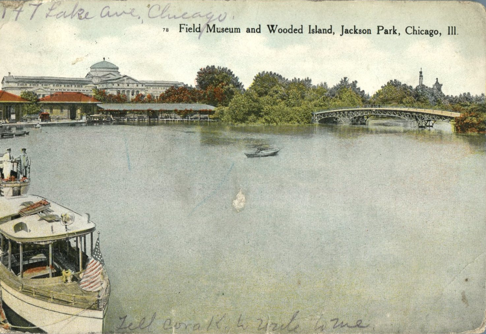
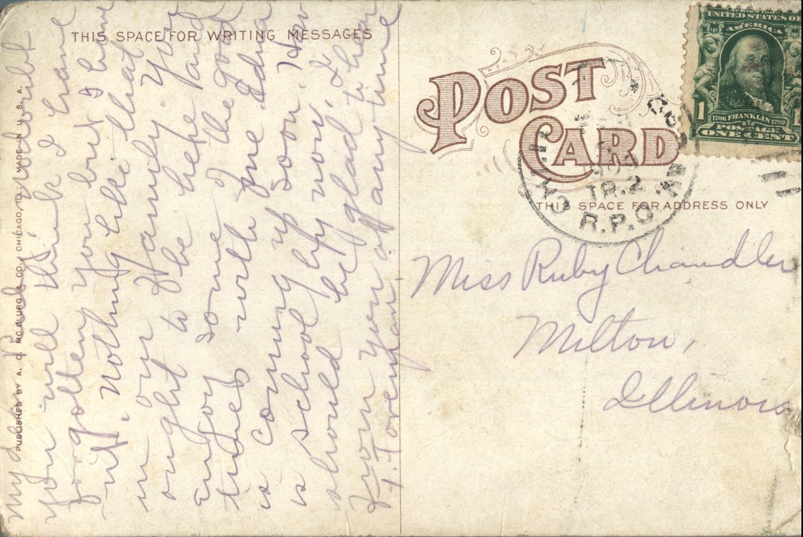

 

From: F. Foreman, To: Ruby Chandler  
Mailed From: Chicago, Illinois in 1909  
Picture Info: Field Museum and Wooded Island, Jackson Park, Chicago, Ill.  
Postcard Info: Published by A. C. McClurg &amp; Co., Chicago, Ill. Made in U.S.A.

Miss Ruby Chandler  
Milton, Illinois

My Dear Ruby,  
Undoubtably, you think I have forgotten you ut I have not. Nothing like that in our family. You ought to be here and enjoy some of the good times with me. Edna is coming up zoo. How is school? By now, I should be glad to hear from you at any time.  
F. Foreman

Written on the Front:  
4147 Lake Ave., Chicago  
Tell Cora K. to write to me.