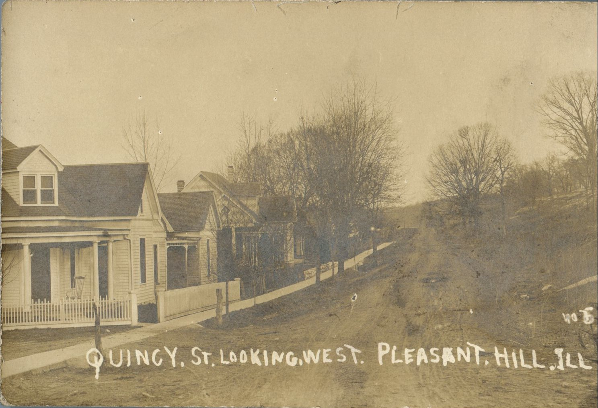
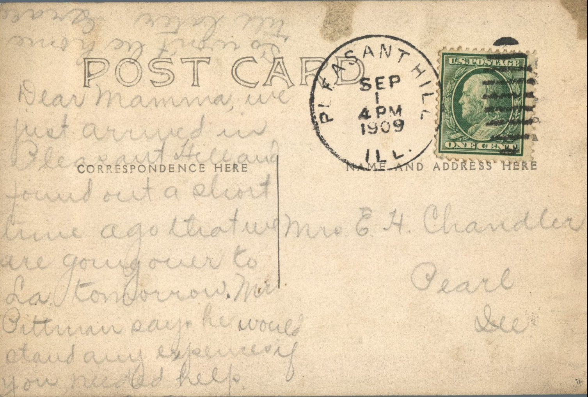

 

From: Grace Chandler, To: Jeanette Knox Chandler  
Mailed From: Pleasant Hill, Illinois on September 1, 1909  
Picture Info: Quincy St. Looking West. Pleasant Hill, Illinois

Mrs. E.H. Chandler  
Pearl, Illinois

Dear mamma,  
We just arrived in Pleasant Hill and found out a short time ago that we are going over to LA tomorrow. Mr. Pittman says he would stand any experiences if you needed help. So won’t be home till later.  
Grace