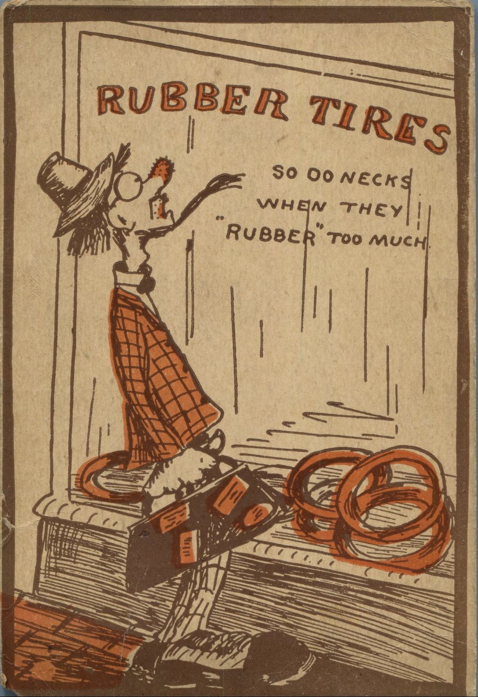
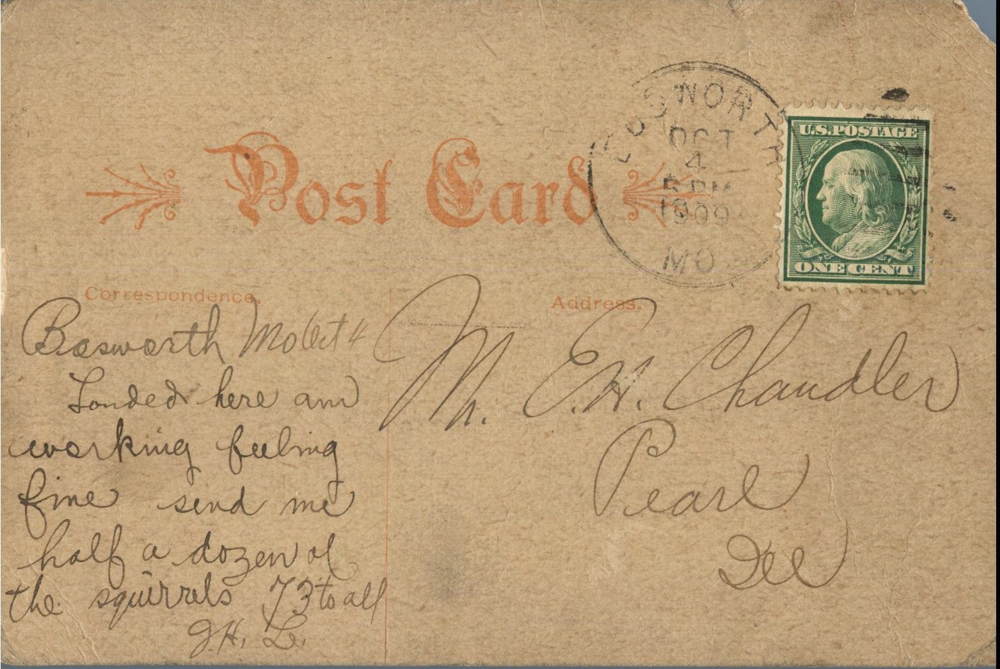

 

From: G.H.L, To: Elijah H. Chandler  
Mailed From: Bosworth, MO on October 4, 1909

Mr. E.H. Chandler  
Pearl, Illinois

Bosworth, MO Oct. 4  
landed here am working. Feeling fine. Send me half a dozen of the squirrels. 73 to all  
G.H.L.