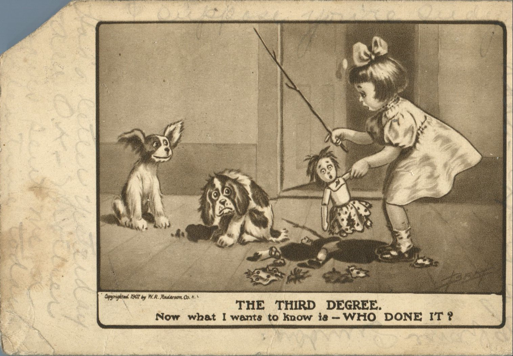
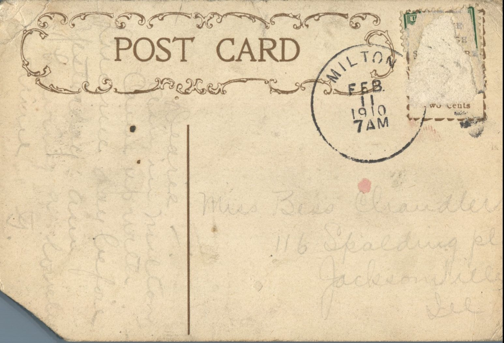

 From: G., To: Bess Chandler  
Mailed From: Milton, Illinois on February 11, 1910  
Picture Info: Copyrighted 1907 by W.R. Anderson. Co.

Miss Bess Chandler  
116 Spalding Pl.  
Jacksonville, Ill.

Dearie,  
Am in Milton. Came up with Lucerne day before yesterday a.m. I write lovingly,  
G.

Written on the Front:  
Had a letter yesterday. All O.K. Write soon.