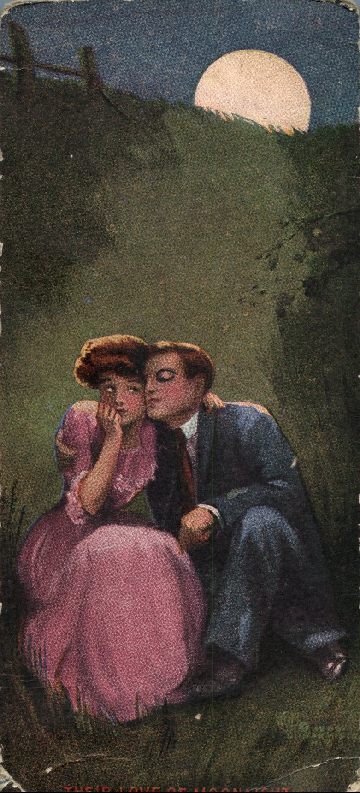
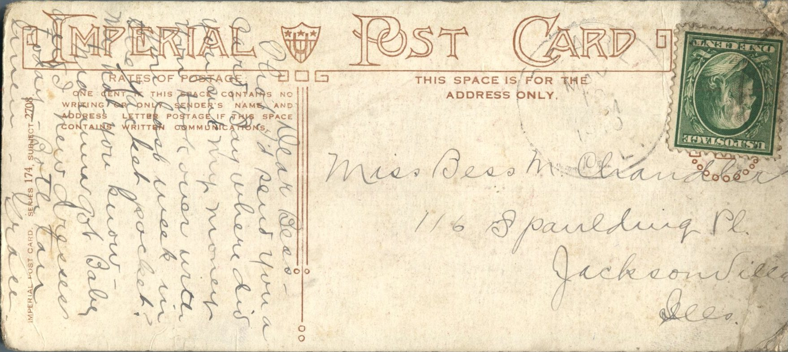

 

From: Grace Chandler, To: Bess M. Chandler  
Mailed From: Pearl, Illinois on May 10, 1910  
Postcard Info: Imperial Post Card. Series 174, Subject 2708

Miss Bess M. Chandler  
116 Spaulding Pl.  
Jacksonville, Illinois

Dear Bess,  
Thouhgt I’d send you a card to say where it is you put my money you took over with you last week in the jacket pocket? My hat you know – Mamma got Baby and I new dresses today – Both are tan linen.  
Grace