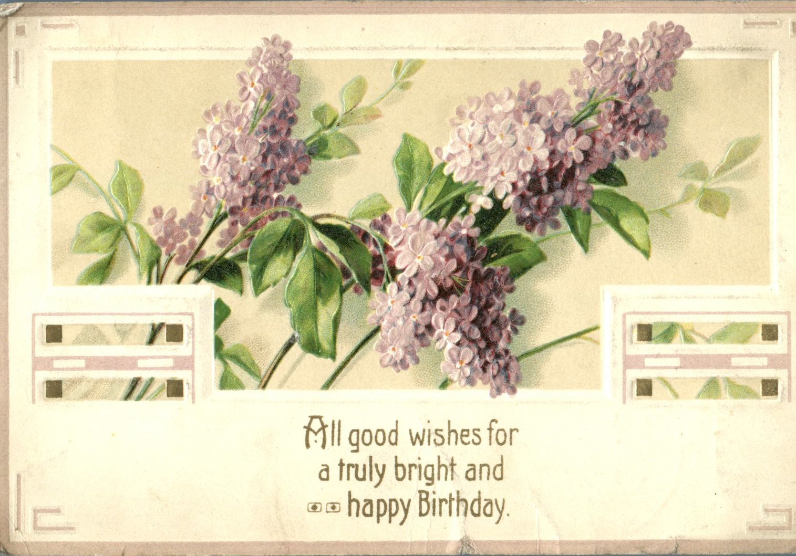
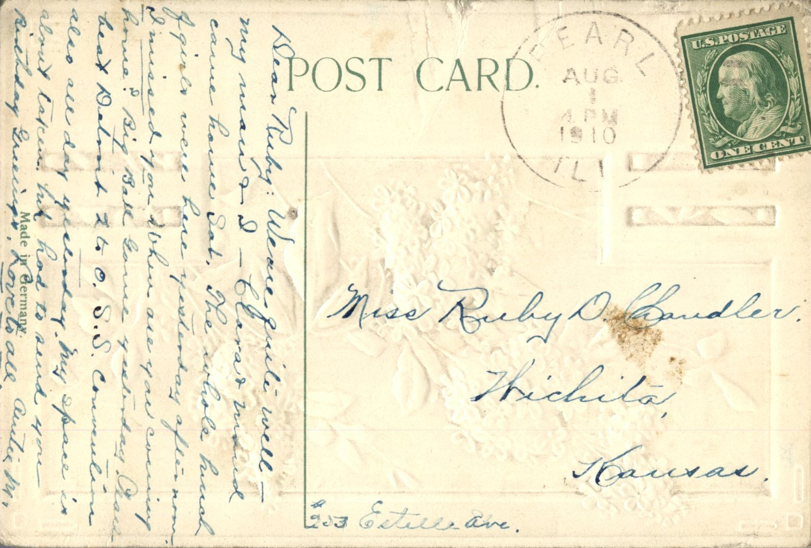

   
From: M. To: Ruby Chandler  
Mailed From: Pearl, Illinois on August 1, 1910  
Postcard Info: Made in Germany

Miss Ruby D. Chandler  
Wichita, Kansas  
903 Estelle Ave.

Dear Ruby,  
We’re quite well my man and I. Clara and Maud came home Saturday. The whole bunch of girls were here yesterday after noon. I missed you. When are you coming home? Big ball game yesterday. Chicago beat Detroit 2 to 0. S.S. Convention also all day yesterday. My space is about taken huh. Had to send you birthday greetings.  
Love to All,  
Auntie M.