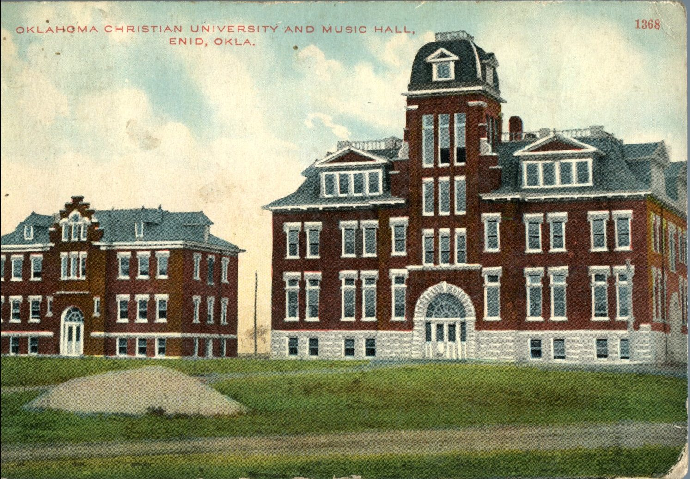
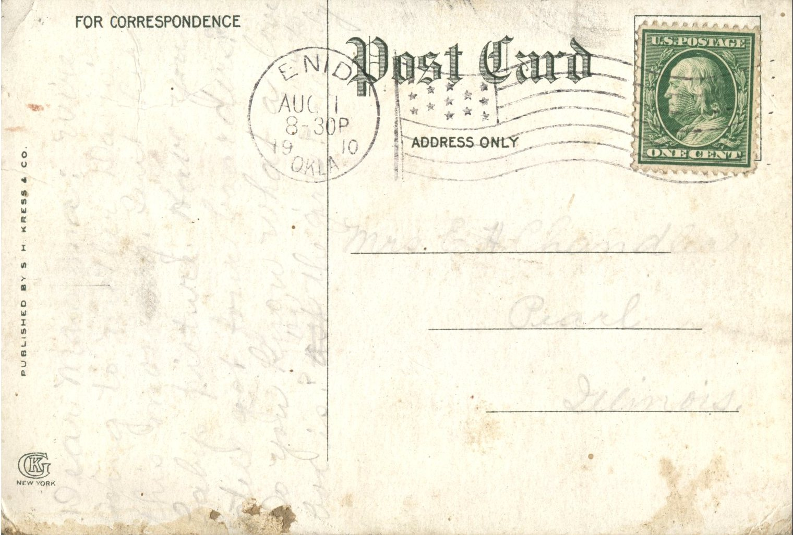

From: Ruby Chandler, To: Jeanette Knox Chandler  
Mailed From: Enid, Oklahoma on August 1, 1910  
Postcard Info: Published by S. H. Kress and Co.  
Picture Info: Oklahoma Christian University and Music Hall, Enid, Okla. No. 1368

Mrs. E. . Chandler  
Pearl, Illinois

Dear Mamma,  
We’re going to Pastor David this morning. Sent her baby picture. Have you still got four good days? Do you know what a love box is? Ask the girls?  
Love all,  
Ruby