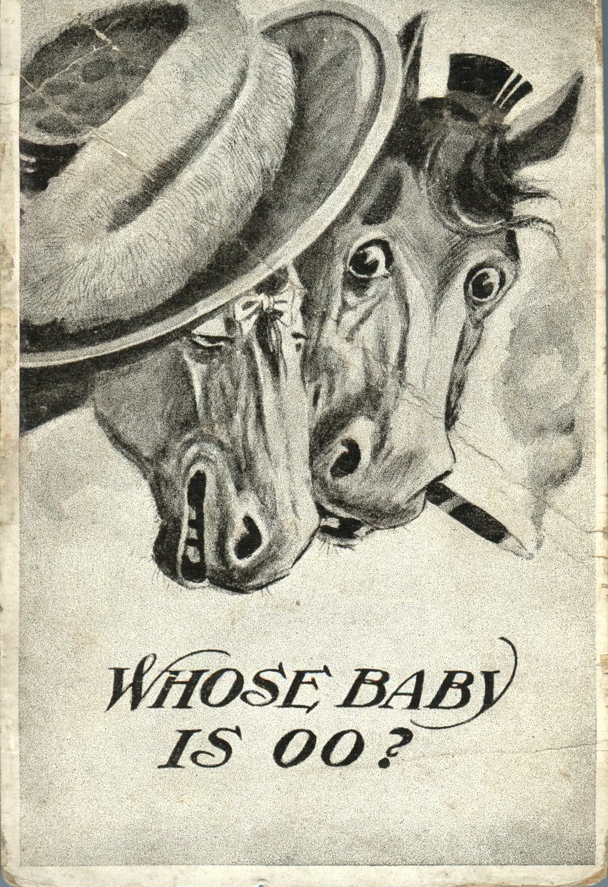
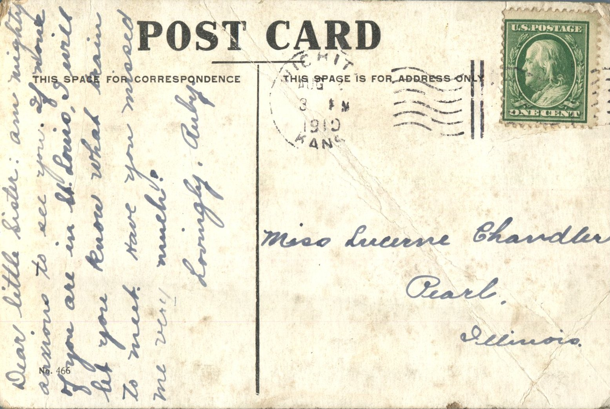

From: Ruby Chandler, To: Lucerne Chandler  
Mailed From: Wichita, Kansas on August 3, 1910

Miss Lucerne Chandler  
Pearl, Illinois

Dear little Sister,  
Am mighty anxious to see you. If none of you are in St. Louis, I will let you know what train to meet. Have you missed me very much?  
Lovingly,  
Ruby