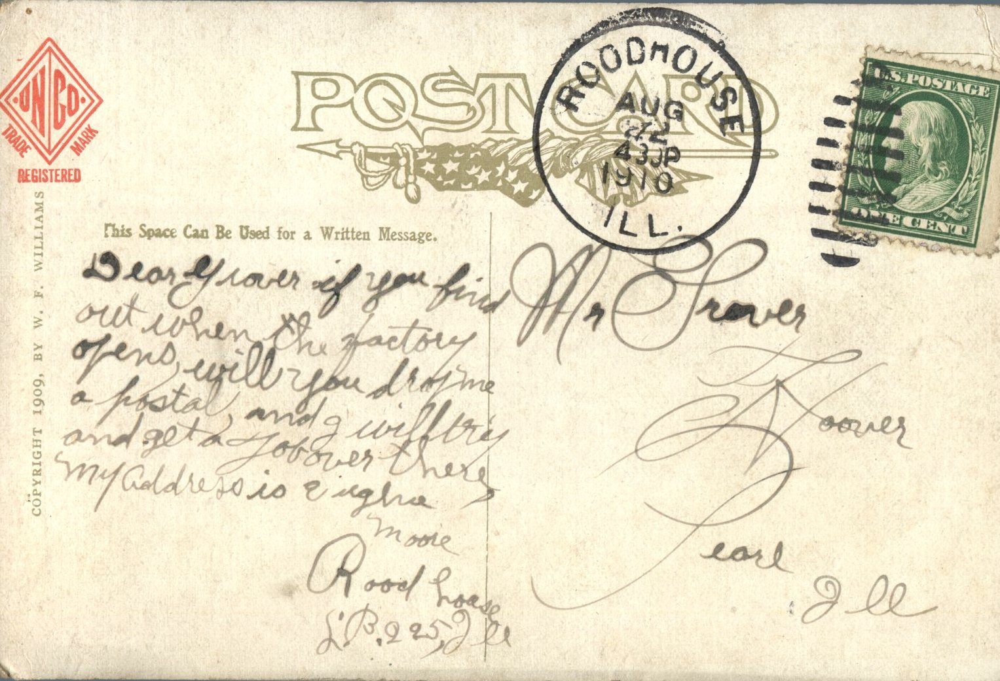

 

From: E. Moore, To: Grover Hoover  
Mailed From: Roadhouse, Illinois on August 22, 1910  
Postcard Info: Copyright 1909, by W. F. Williams

Mr. Grover Hoover  
Pearl, Illinois

Dear Grover,  
If you find out when the factory opens, will you drop me a postal and I will try and get a job over there. My address is  
E. Moore  
Roadhouse  
L.B. 225, Illinois