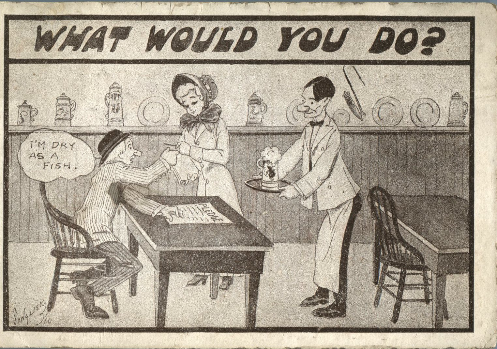
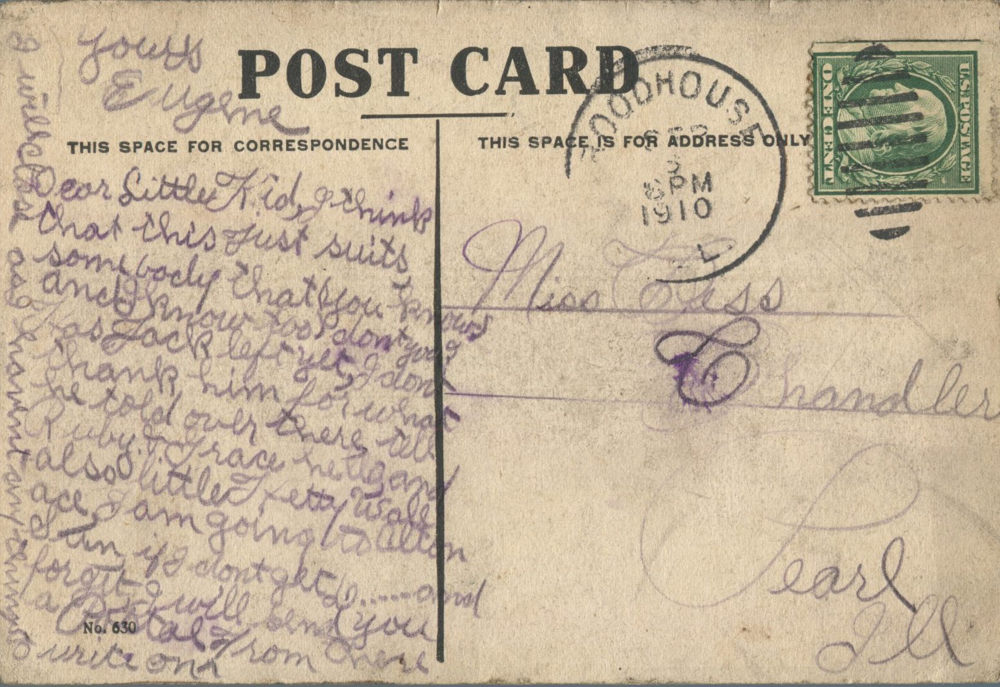

 From: Eugene, To: Bess Chandler  
Mailed From: Roadhouse, Illinois on September 6, 1910

Miss Bess Chandler  
Pearl, Illinois

Dear Little Kid,  
I think that this just suits somebody that you know (and I know too) don’t it? Has Jack left yet? I don’t thank him for what he told over there. Tell Ruby and Grace, and also little petty Wallace I am going to Alton. So if I don’t forget, I all send you a postal from there. I will close as I haven’t anything to write more.  
Yours,  
Eugene