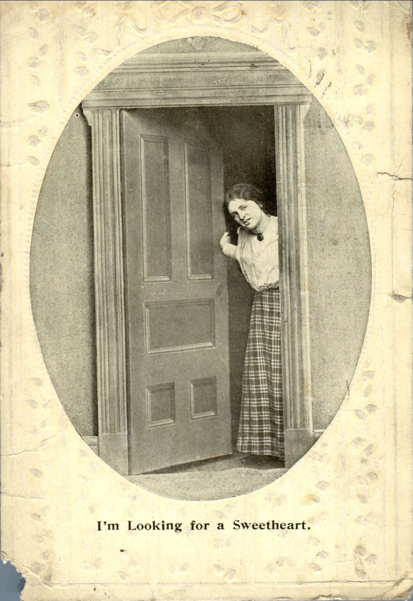
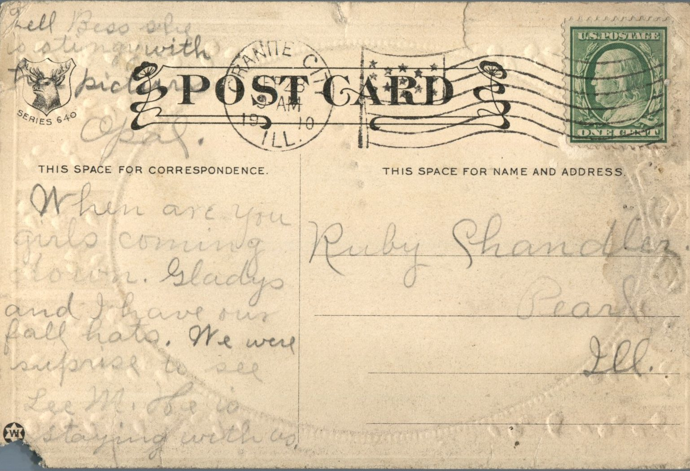

   
From: Opal Chandler, To: Ruby Chandler  
Mailed From: Granite City, Illinois on September 28, 1910

Ruby Chandler  
Pearl, Illinois

When are you girls coming down. Gladys and I have our fall hats We were surprised to see Lee M. He is staying with us. Tell Bess she is stingy with pictures.  
Opal