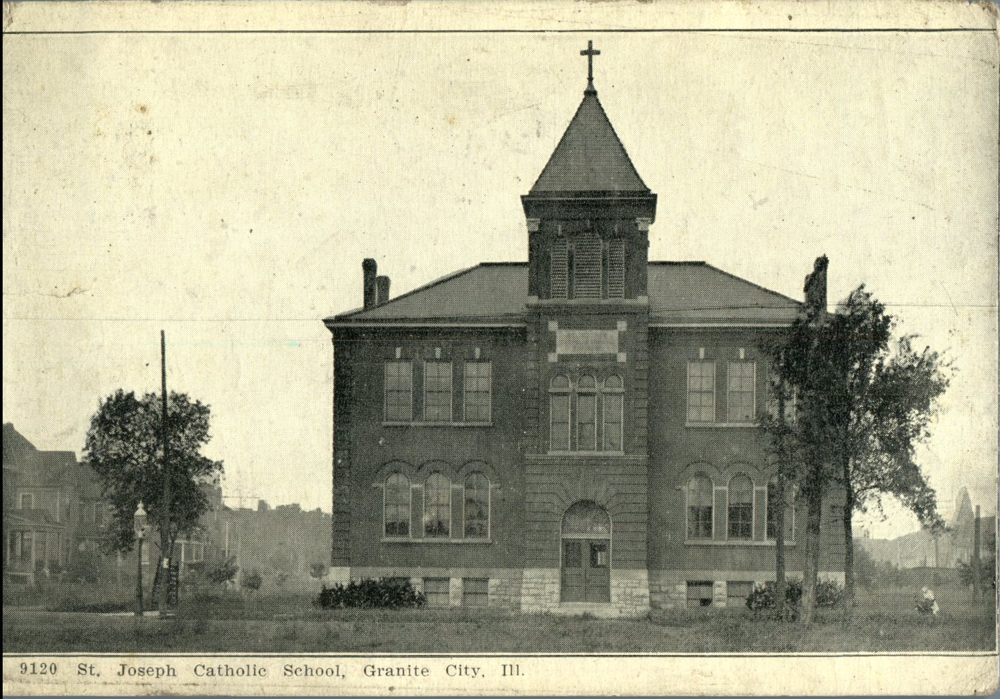
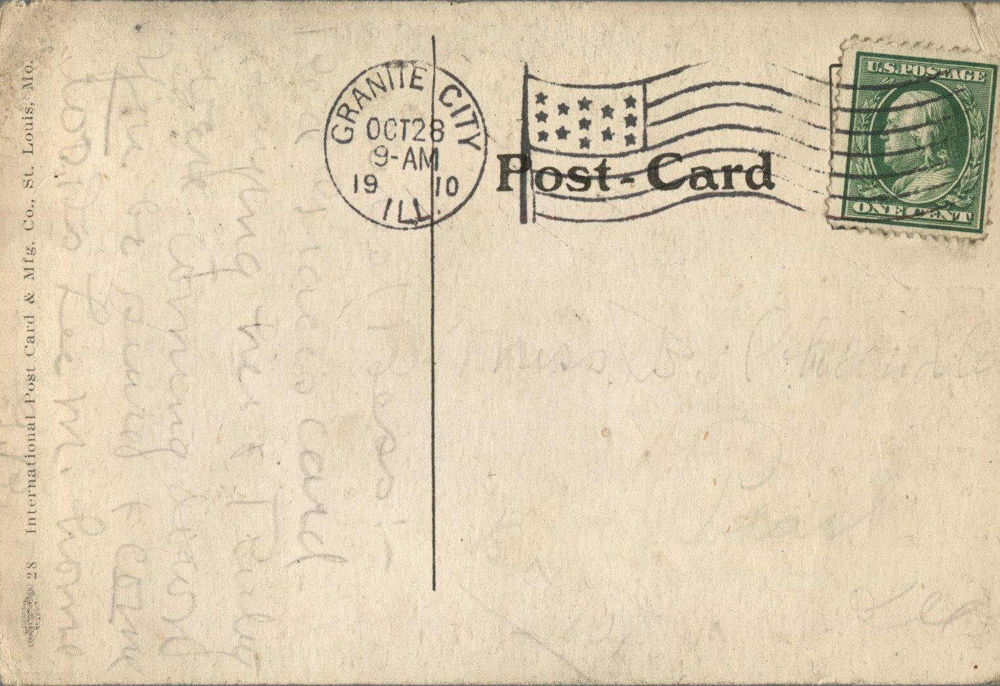

 

From: G.B., To: Bess Chandler  
Mailed From: Granite City, Illinois on October 28, 1910  
Postcard Info:International Postcard &amp; Mfg. Co., St. Louis, Mo.  
Picture Info: 9120 St. Joseph Catholic School, Granite City, Ill.

Miss B. Chandler  
Pearl, Illinois

Dearest Bess,  
Read Grace’s card saying her and Ruby were coming down. You be sure to come too. Dr. Lee M. home  
G.B.