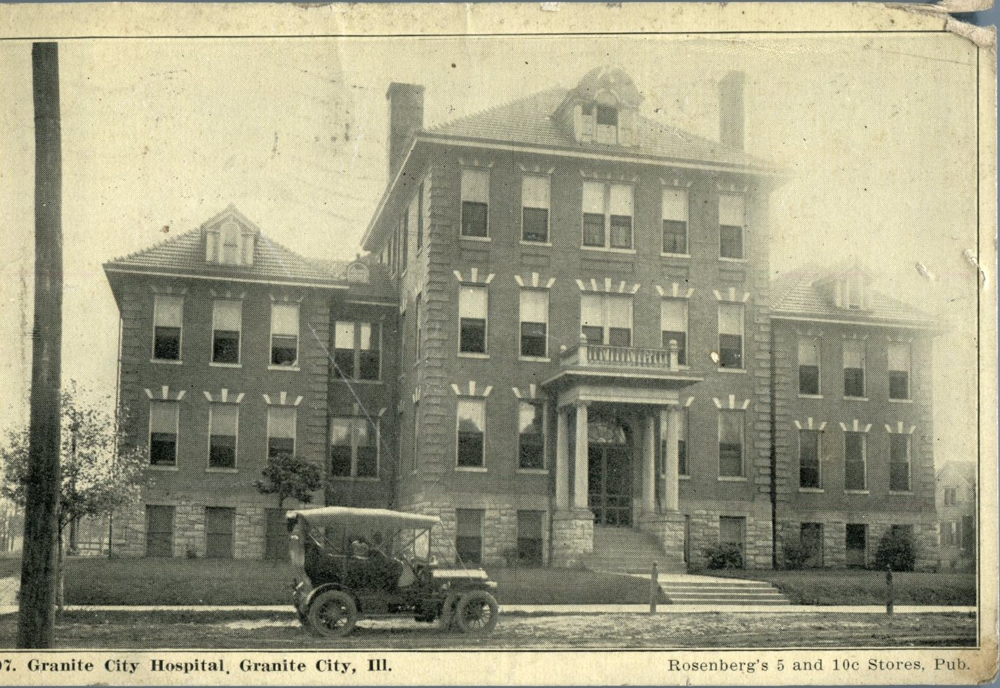
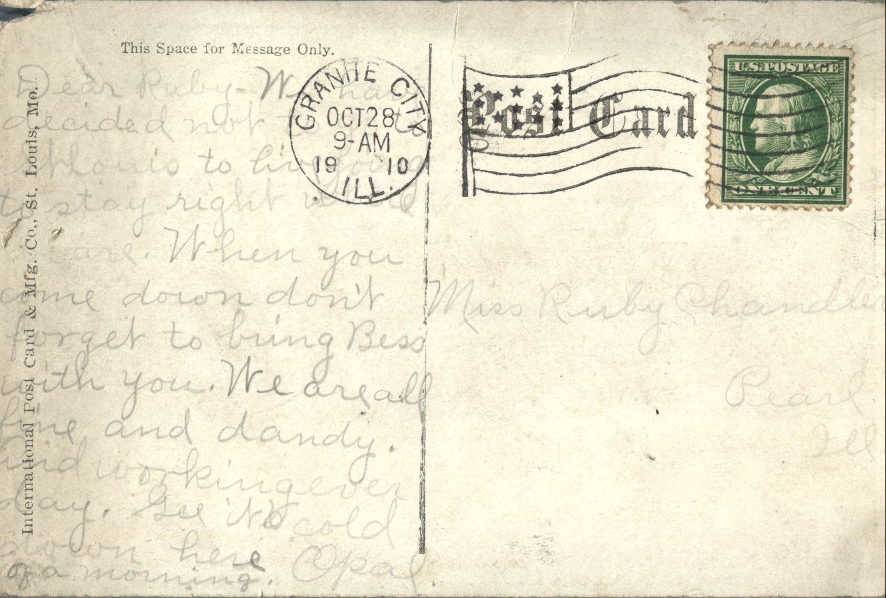

 

From: Opal Chandler, To: Ruby Chandler  
Mailed From: Granite City, Illinois on October 28, 1910  
Postcard Info: International Postcard &amp; Mfg. Co., St. Louis, Mo.  
Picture Info: 9007. Granite City Hospital, Granite City, Ill. Rosenberg’s 5 and 10c Stores, Pub.

Miss Ruby Chandler  
Pearl, Illinois

Dear Ruby,  
We have decided not to go to St. Louis to live. Decided to stay right where we are. When you come down, don’t forget to bring Bess with you. We are all fine and dandy and working everyday. Gee its cold down here in the morning.  
Opal