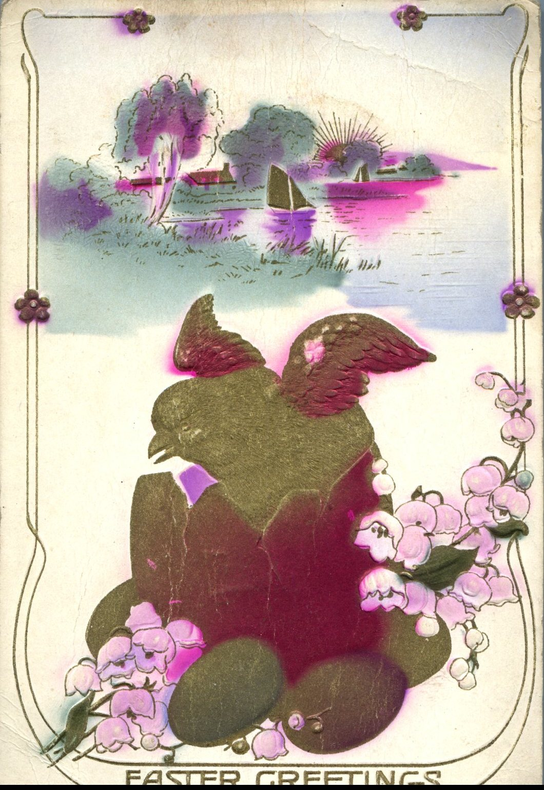
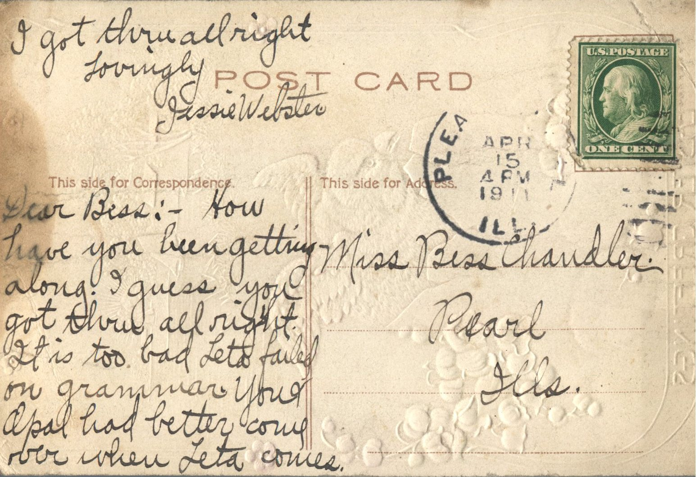

 

From: Jessie Webster, To: Bess Chandler  
Mailed From: Pleasantville, Illinois on April 15, 1911

Miss Bess Chandler  
Pearl, Illinois

Dear Bess;  
How have you been getting along? I guess you got through all right. It is too bad Leta failed on grammar. You and Opal had better come over when Leta comes. I got through all right.  
Lovingly,  
Jessie Webster