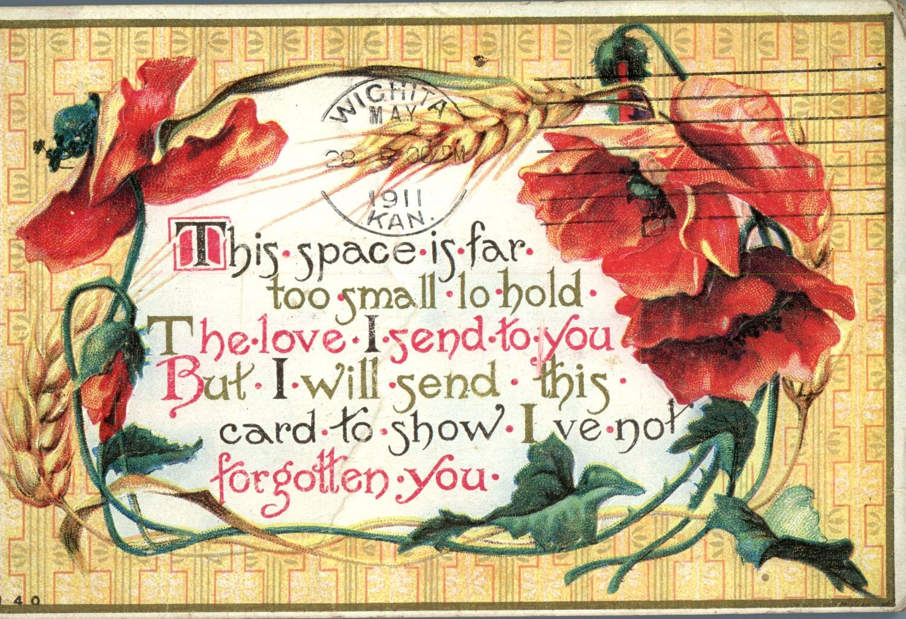
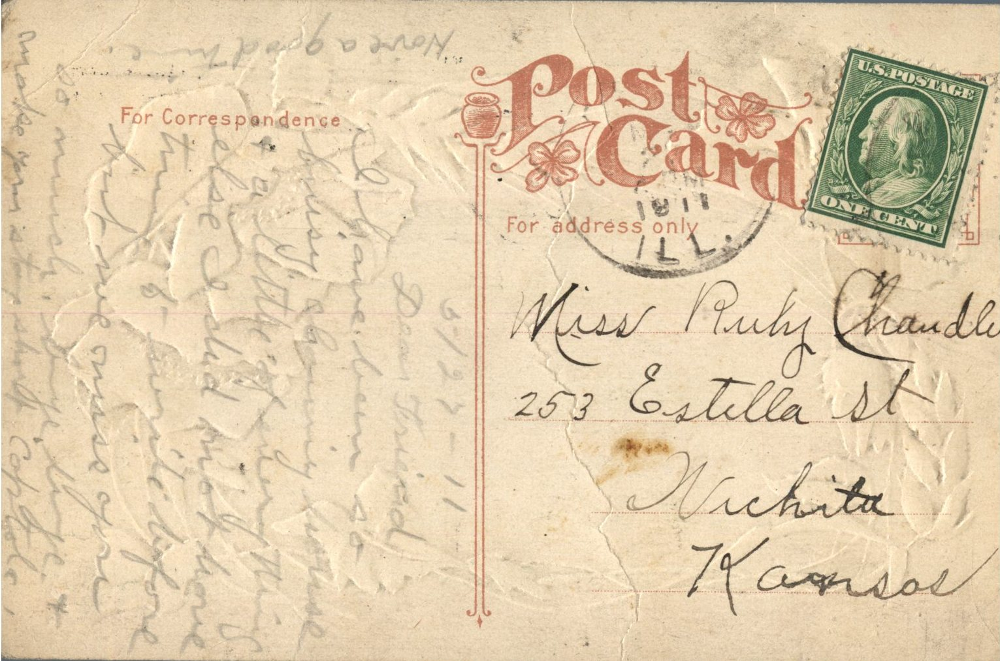

 

From: Unknown, To: Ruby Chandler  
Mailed From: Wichita, Kansas on May 8, 1911

Miss Ruby Chandler  
253 Estille St.  
Wichita, Kansas

5-27-11  
Dear Friend,  
I have been so busy cleaning house and a little of everything else. I did not have time to write before but we miss you so much. Bye now, and make your stay short . Have a good time.