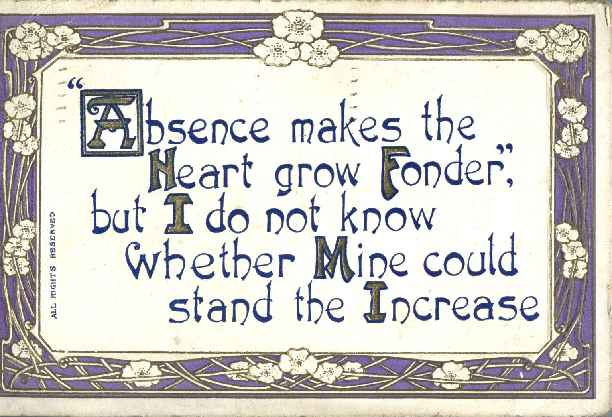
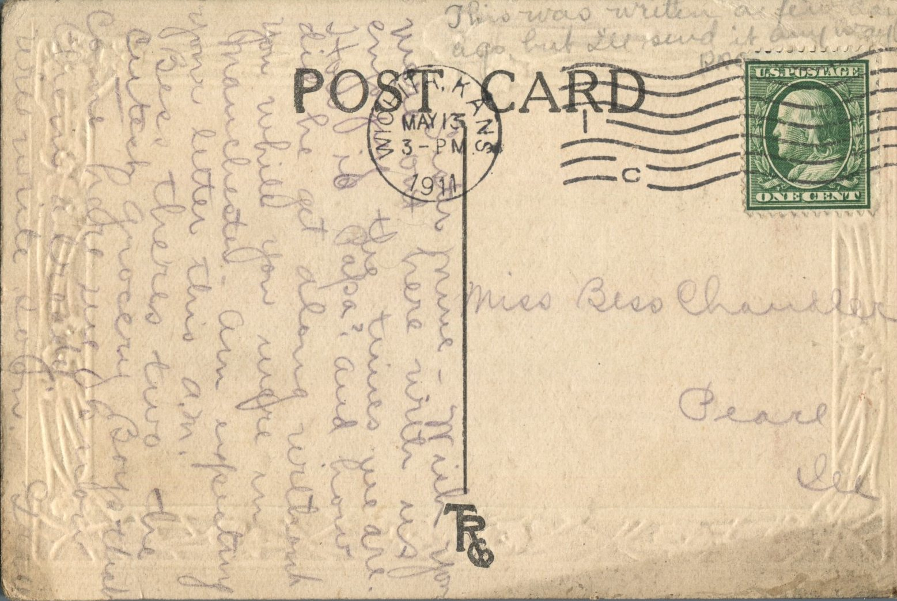

 From: Grace Chandler, To: Bess Chandler  
Mailed From: Wichita, Kansas on May 13, 1911

Miss Bess Chandler  
Pearl, Illinois

Sister mine,  
Wish you were out here with us enjoying the times we are. How is Papa? And how did he get along without you while you were in Manchester? Am expecting your letter this a.m.  
Bess there’s two of the cutest grocery boys that came here. We know they already.  
Will write soon.  
Grace  
This was written a few days ago but I’ll send it anyway.