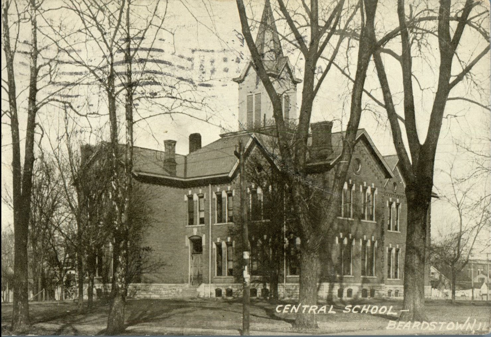
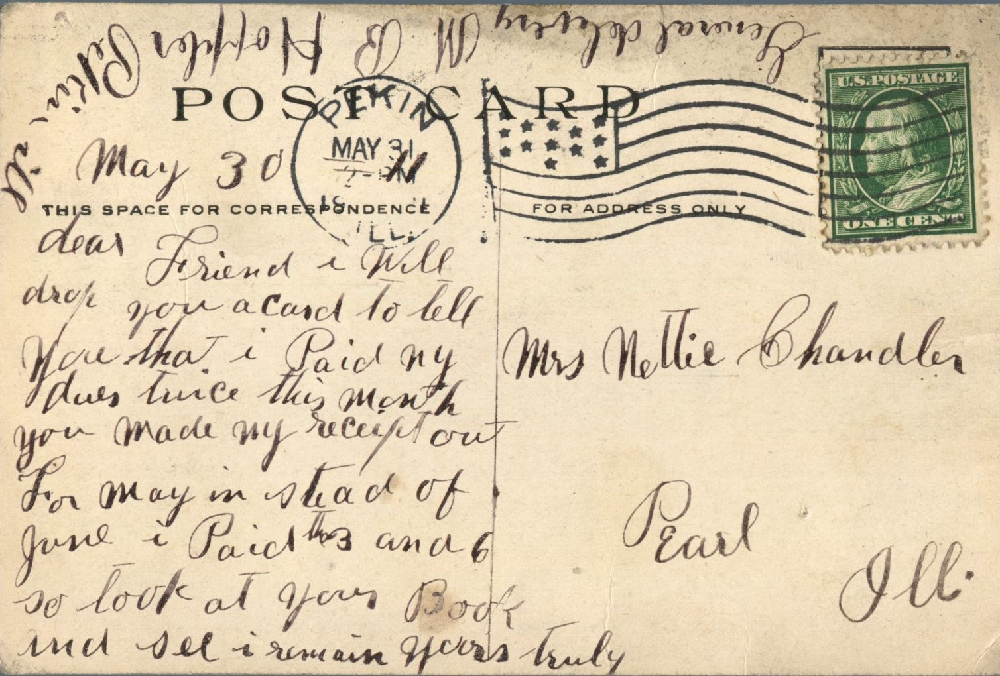

 

From: M.B. Hoppler, To: Jeanette Knox Chandler  
Mailed From: Pekin, Illinois on May 31, 1911

Mrs. Nettie Chandler  
Pearl, Illinois

May 30  
Dear Friend,  
I will drop you a card to tell you that I paid my dues twice this month. You made my reciept out for May instead of June. I paid the 3 and 6 so look at your book and still I remain yours truly,  
General Delivery M.B. Hoppler  
Pekin, Illinois