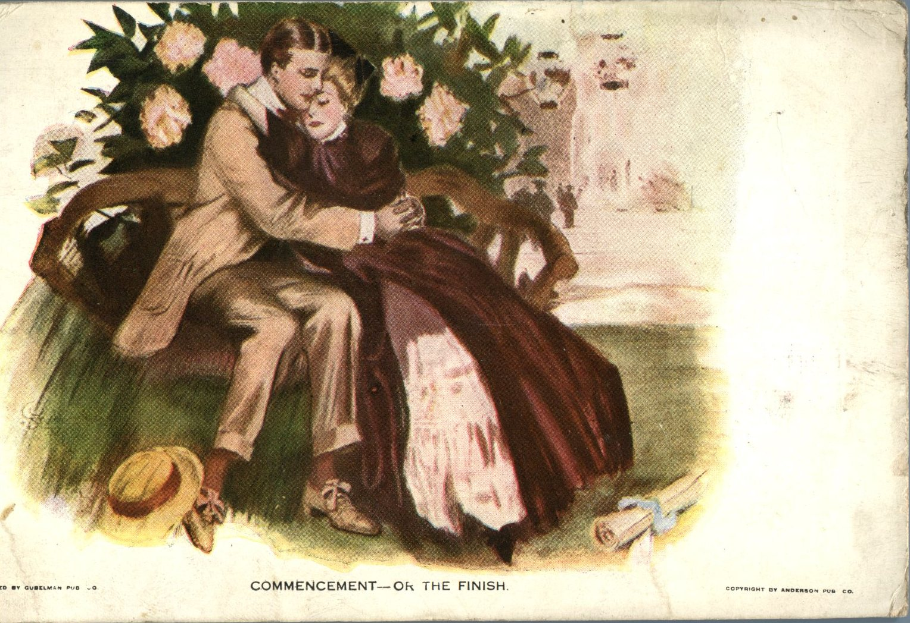
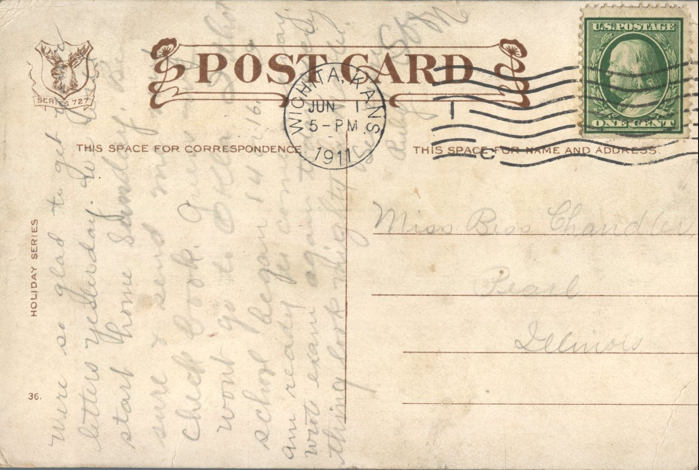

 

From: Ruby Chandler, To: Bess Chandler  
Mailed From: Wichita, Kansas on June 1, 1911

Miss Bess Chandler  
Pearl, Illinois

Were so glad to get your letters yesterday. We will start home Sunday. Be sure to send me new chick book. Decided won’t go to Oklahoma. I thought school began 14th or 16th. Are you ready to come out and stay? Wrote exam again today and the thing look mighty fine. Well, see you soon.  
Ruby