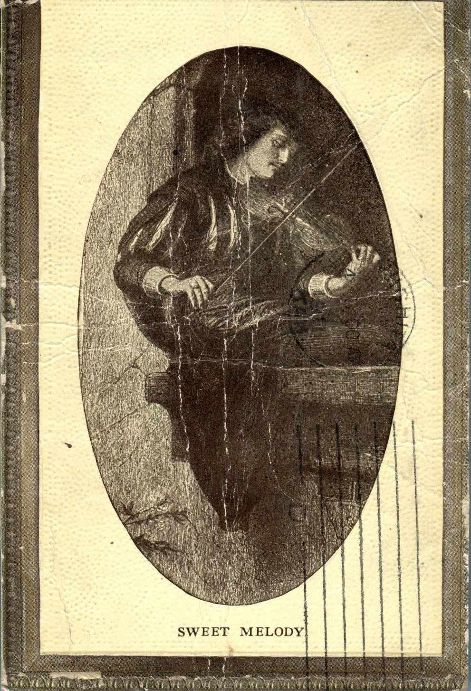
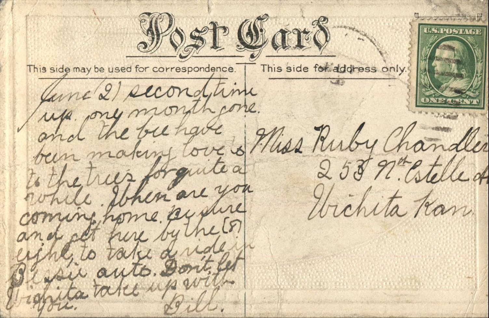

  
From: Bill, To: Ruby Chandler  
Mailed From: Wichita, Kansas on June 21, 1911

Miss Ruby Chandler  
253 N. Estelle Ave.  
Wichita, Kansas

June 21 second time up. Only month one and the bees have been making love to the trees for quite a while . When are you coming home. Be sure and get here by the eighth, to take a ride in Bessie’s auto. Don’t let Wichita take up with you.  
Bill