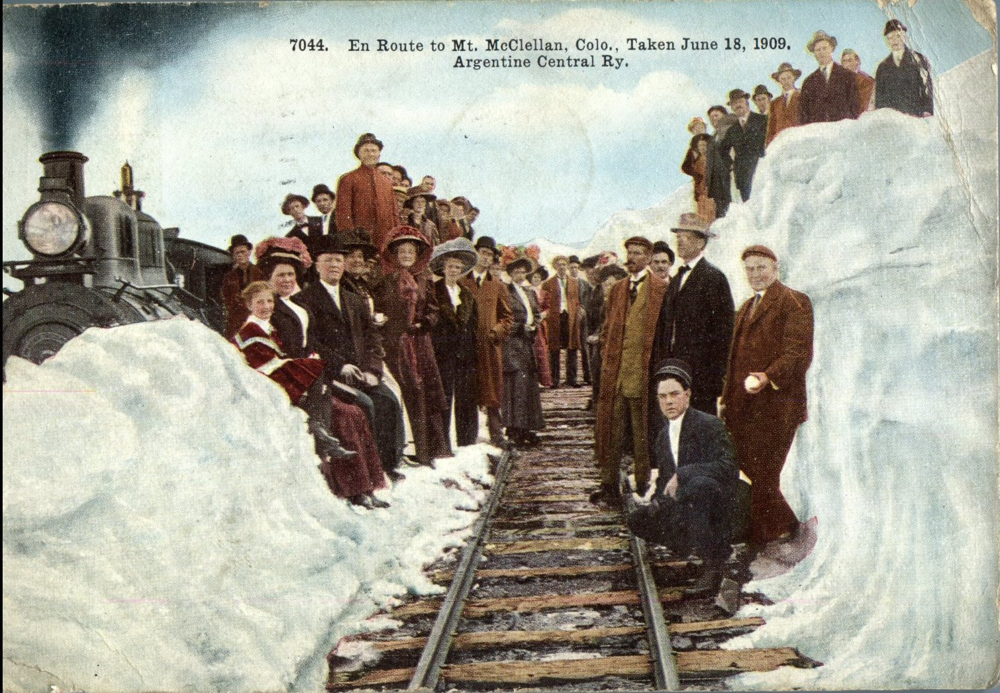
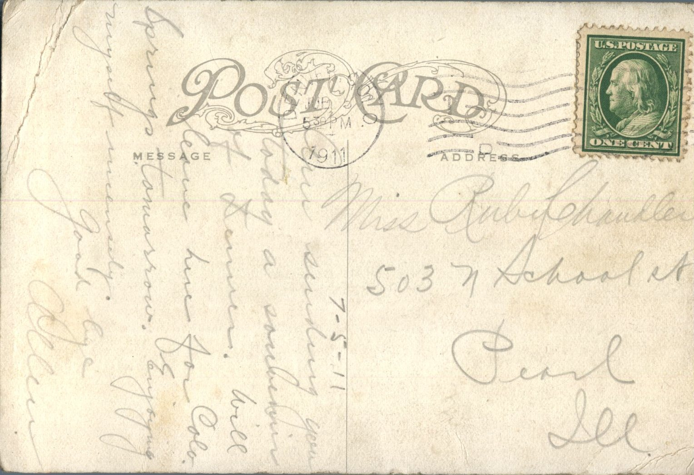

 

From: Allen, To: Ruby Chandler  
Mailed From: Denver, Colorado on July 5, 1911  
Picture Info: 7044. En Route to mt. McClellan, Colo., Taken June 18, 1909. Argentine Central Ry.

Miss Ruby Chandler  
503 N. School St.  
Pearl, Illinois

7-5-11  
Am sending you today a souvenir of Denver. Will leave here for Colorado Springs tomorrow. Enjoying myself immensely.  
Good Bye,  
Allen