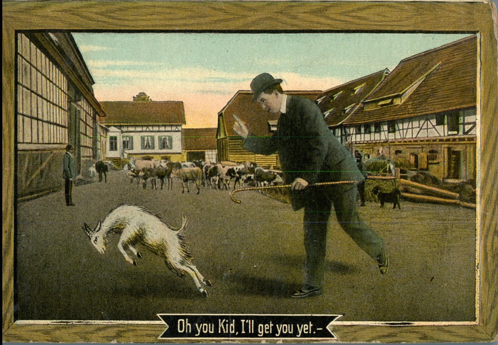
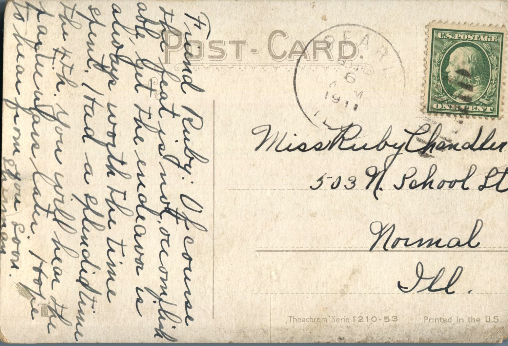

 

From: Lhennay, To: Ruby Chandler  
Mailed From: Pearl, Illinois on July 6, 1911

Miss Ruby Chandler  
503 N. School St.  
Normal, Illinois

Friend Ruby,  
Of course the feat is not accomplishable, yet the endeavor is always worth the time spent. Had a splendid time on the 4th. You will hear the particulars later. Hope to hear from you soon.  
Lhennay