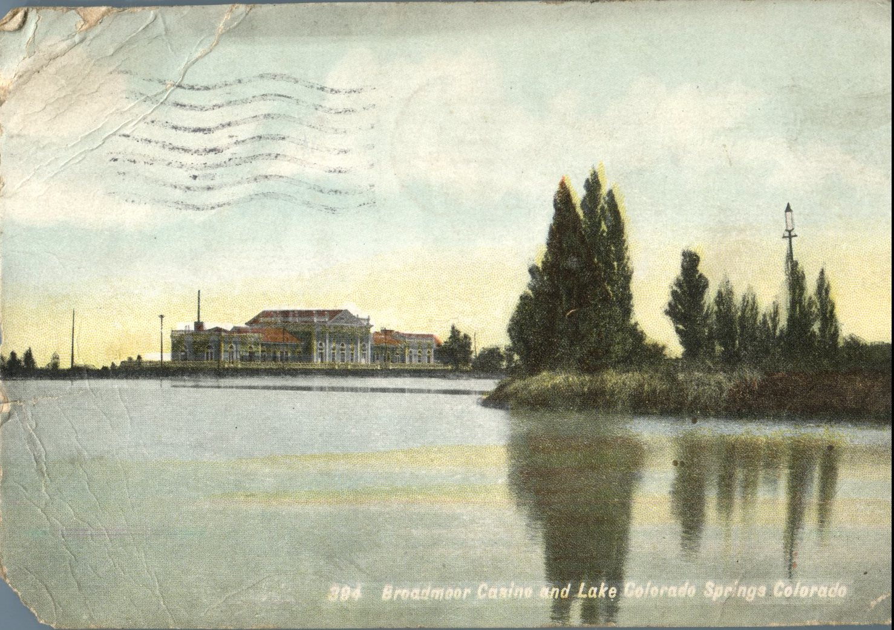
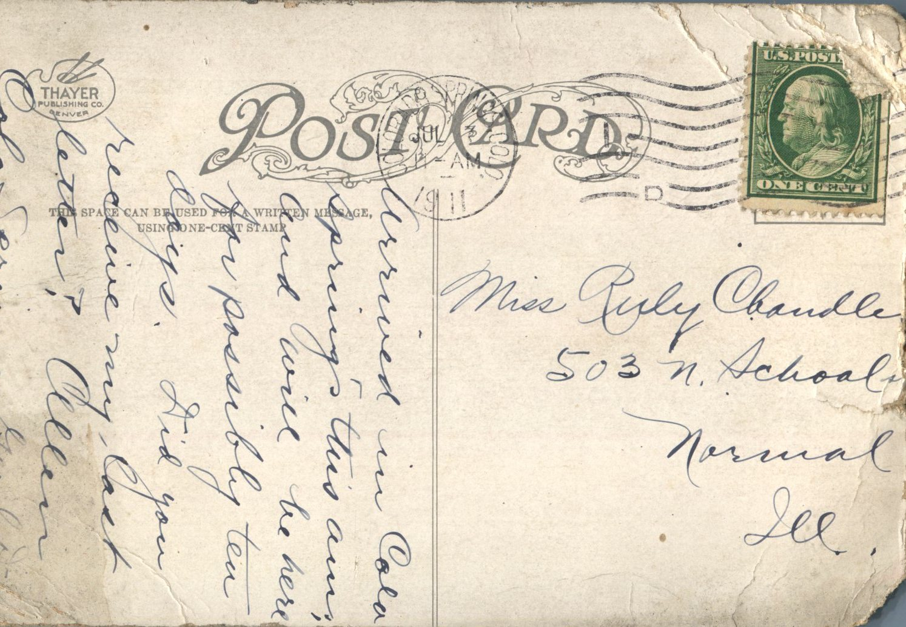

 

From: Allen, To: Ruby Chandler  
Mailed From: Colorado Springs, Colorado on July 7, 1911  
Postcard Info: Thayer Publishing Co. Denver  
Picture Info: 394 Broadmoor Casino and Lake, Colorado Springs, Colorado

Miss Ruby Chandler  
503 N. School St  
Normal, Illinois

Arrived in Colorado Springs this a.m. and will be here for possibly ten days. Did you receive my last letter?  
Allen  
Colorado Springs