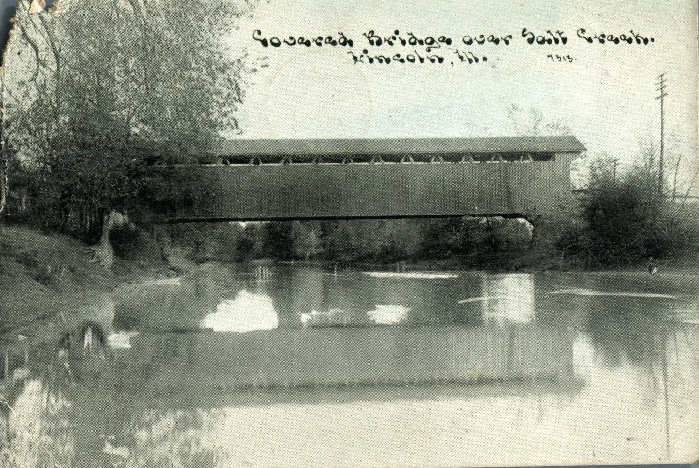
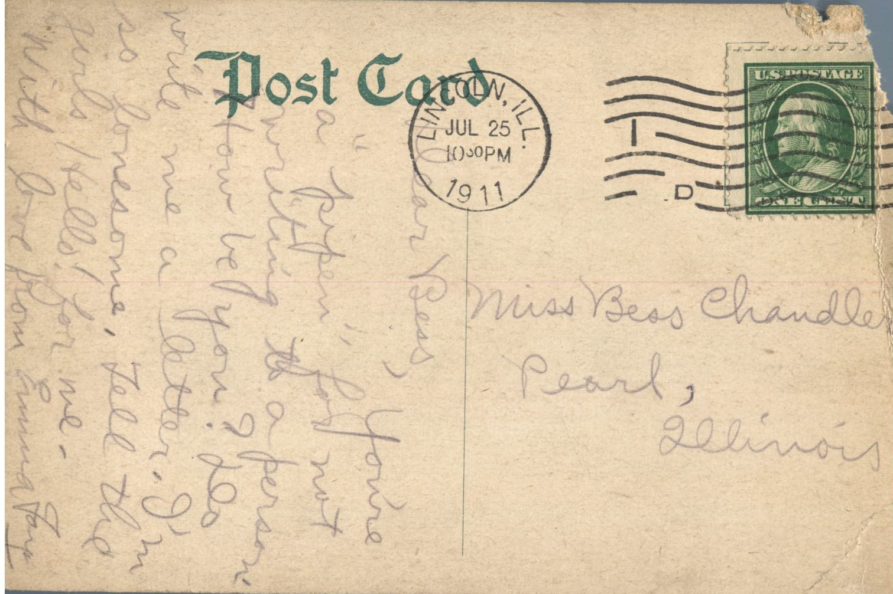

From: Emma Jay, To: Bess Chandler  
Mailed From: Lincoln, Illinois on July 25, 1911  
Picture Info: Covered Bridge over Salt Creek. Lincoln, Illinois 7313

Miss Bess Chandler  
Pearl, Illinois

Dear Bess,  
You’re a “pipen” for not writing to a person. How be you? Do write me a letter. I’m so lonesome. Tell the girls Hello! for me.  
With love from,  
Emma Jay