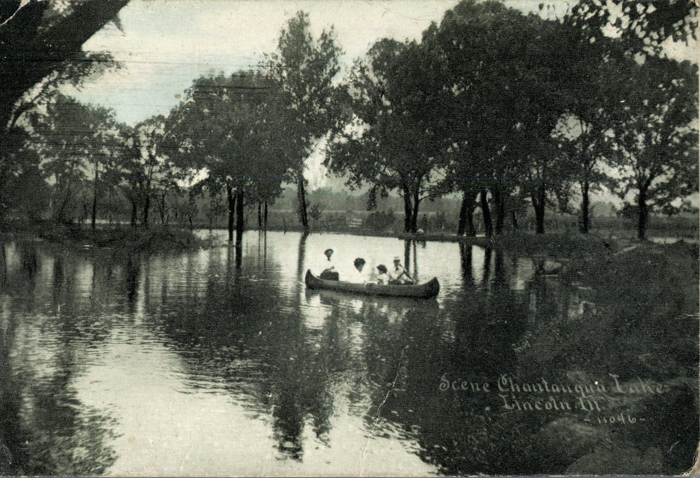
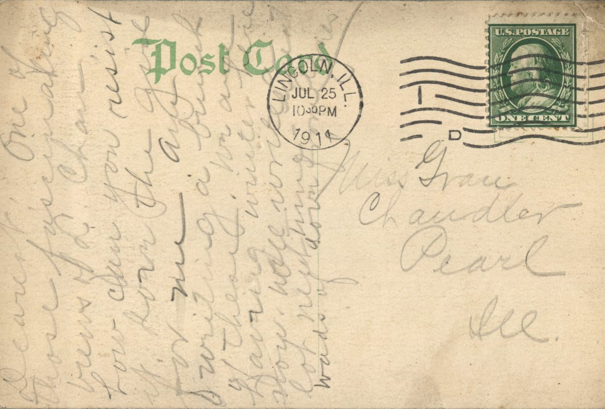

From: Unknown, To: Grace Chandler  
Mailed From: Lincoln, Illinois on July 25, 1911  
Picture Info: Scene Chantangua Lake, Lincoln, Illinois – 11046

Miss Grace Chandler  
Pearl, Illinois

Dearest,  
One of those fascinating letters of L. Chandler. How can you resist it? Hug the girls for me. Am writing a bunch of those. We are having winter here now. Will write a lot next time. Words of love from me.