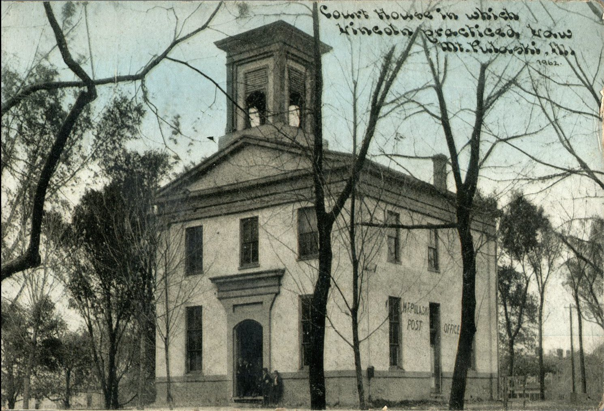
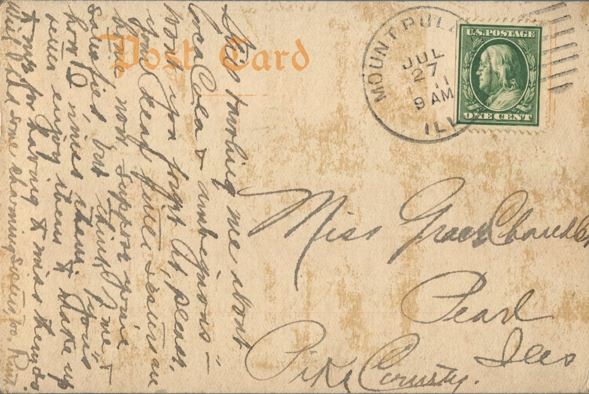

From: Ruth, To: Grace Chandler  
Mailed From: Mount Pulaski, Ill on July 27, 1911  
Picture Info: Court House in which Lincoln Practiced Law. Mt. Pulaski, Ill.

Miss Grace Chandler  
Pearl, Ill.  
Pike County

Still telling me about Coca Cola and ambiguous – know you fought it, please you keep those sisters secure in the house. Now suppose your satisfied but think of me and how I miss them. You better enjoy them and make up with them for me for missing them too. Wish I had some charming sisters, too.  
Ruth