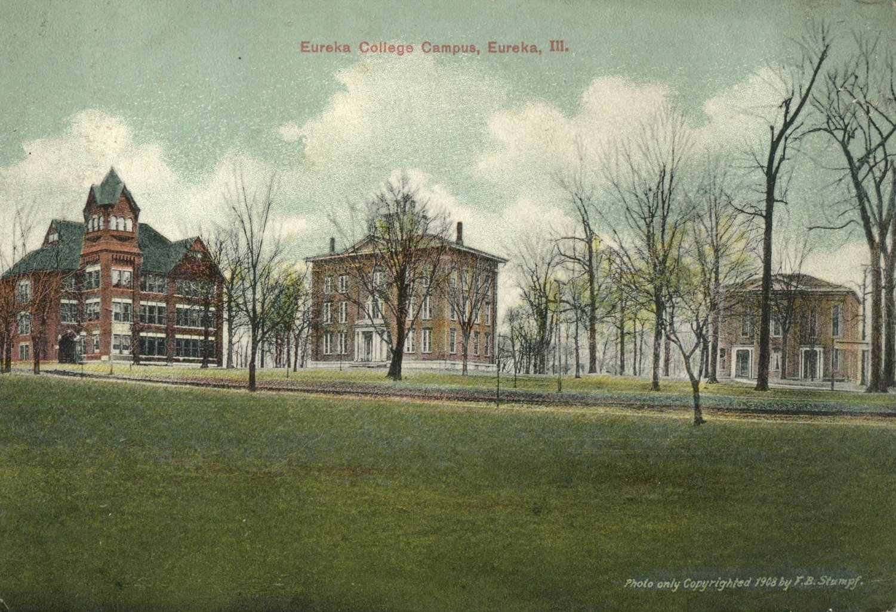
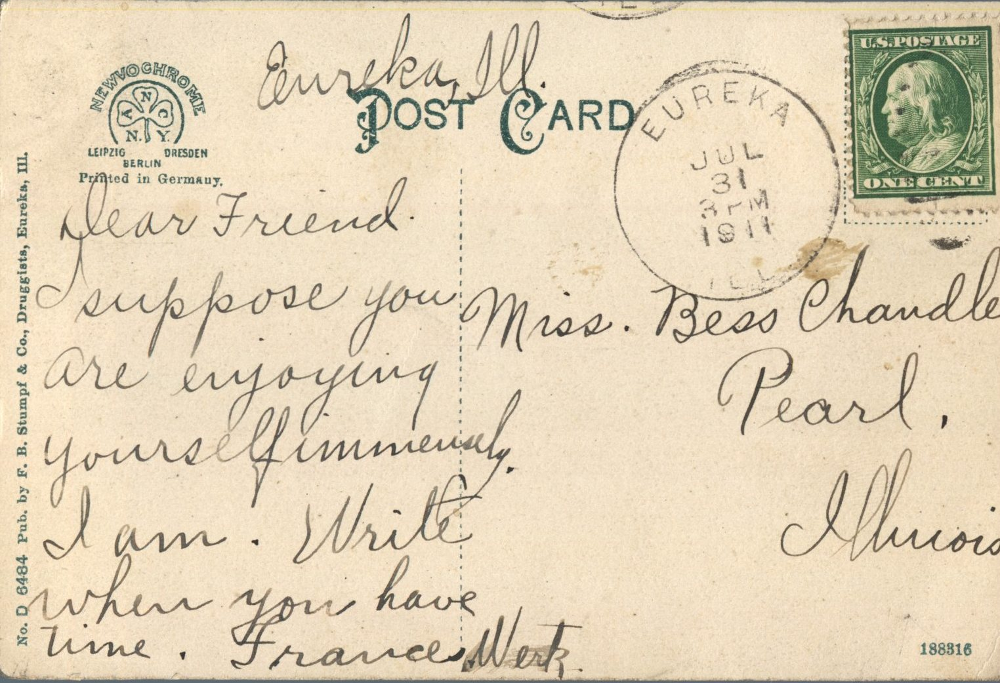

 

From: Frances Werk, To: Bess Chandler  
Mailed From: Eureka, Illinois on July 31, 1911  
Postcard Info: No. D 6484 by F. B. Stumpf &amp; Co., Druggists, Eureka, Ill.  
Picture Info: Eureka College Campus, Eureka, Ill. Photo only Copyrighted 1908 by F. B. Stumpf

Miss Bess Chandler  
Pearl, Illinois

Eureka, Ill.  
Dear Friend,  
I suppose you are enjoying yourself immensely. I am. Write when you have time.  
Frances Werk