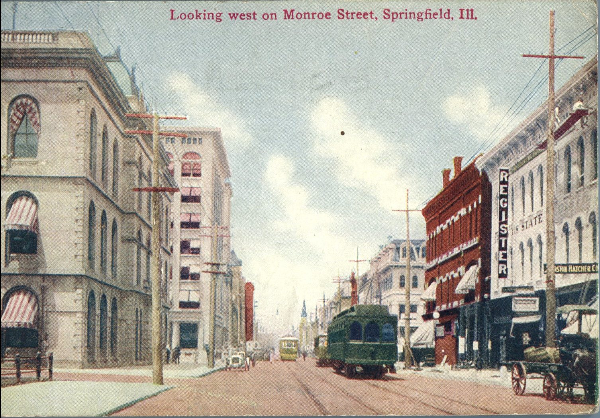
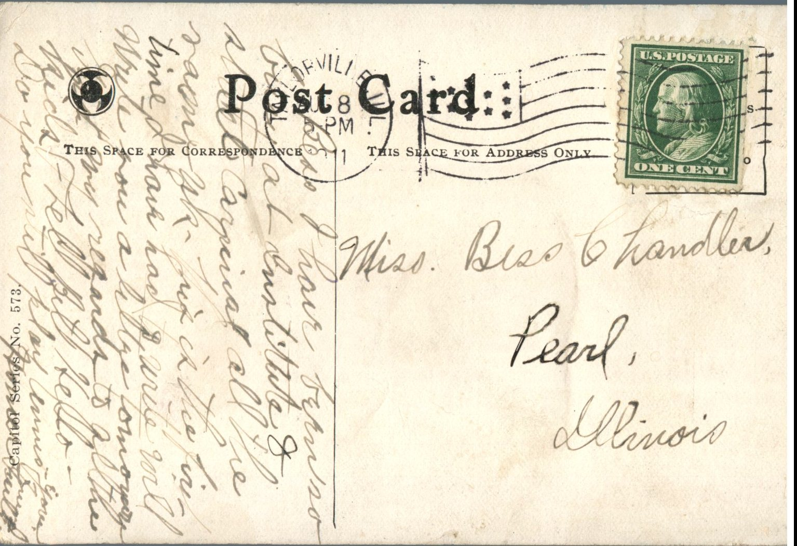

From: Unknown, To: Bess Chandler  
Mailed From: Taylorville, Illinois on August 8, 1911  
Postcard Info: Capitol Series No. 573  
Picture Info: “Looking West on Monroe Street, Springfield, Ill.”

Miss Bess Chandler  
Pearl, Illinois

Bess I have been so busy at Institute and state carnival all over. This is the first time I have had to write. Will write now, a little tomorrow. Give my regards to all the kids. Tell Beth hello. Do you still play tennis? Yours truly.