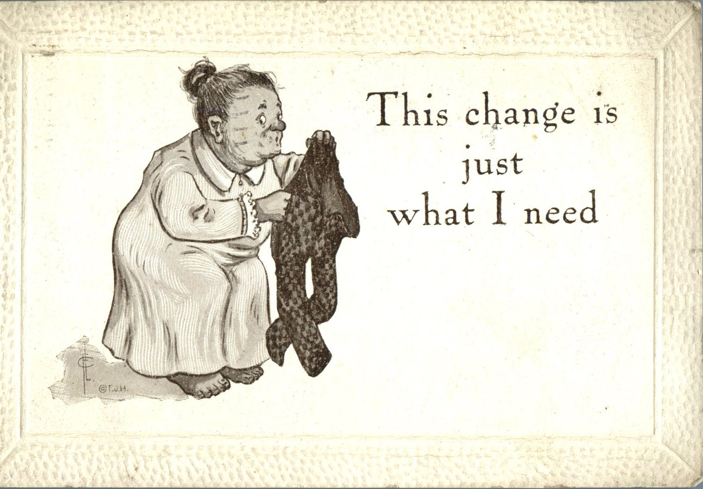
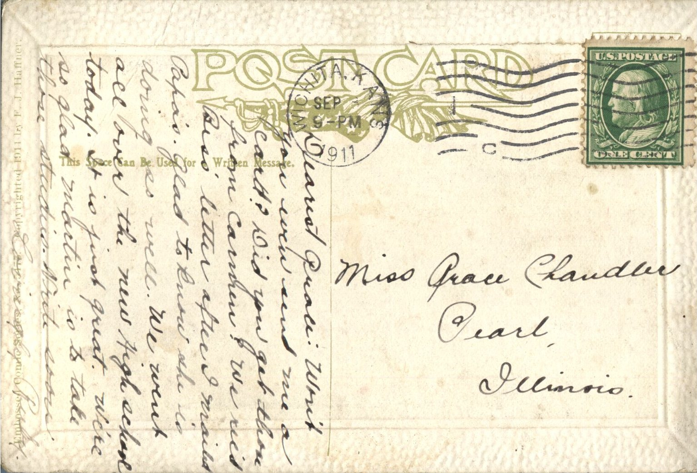

 

From: Ruby Chandler, To: Grace Chandler  
Mailed From: Wichita, Kansas on September 8, 1911  
Postcard Info: Embossed Comic Series No. 5475. Copyrighted 1911 by E.J. Haffner

Miss Grace Chandler  
Pearl, Illinois

Dearest Grace:  
Won’t you even send me a card? Did you get those from Carmen? We received Bess’ letter after I mailed Papa’s. Glad to low she is doing so well. We went all over to the new high school today. It is just great. We’re so glad Martin is to tie those studies. Write soon.  
Lovingly,  
Ruby