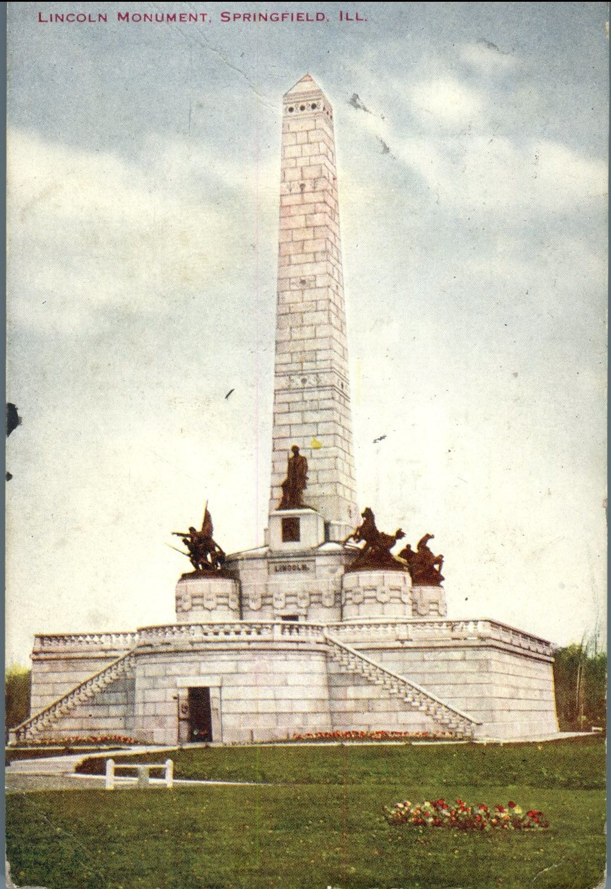
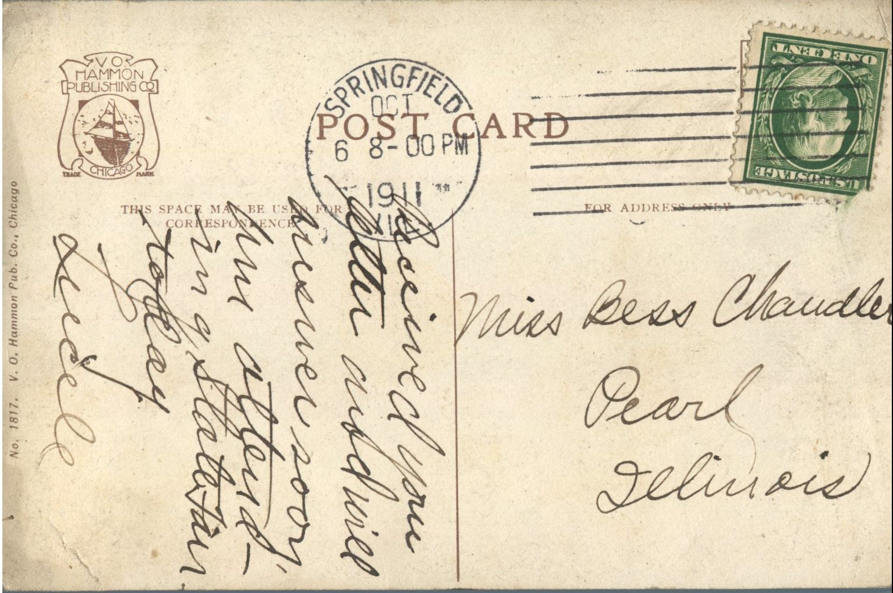

 

From: Lucile Hardin, To: Bess Chandler  
Mailed From: Springfield, Illinois on OCtober 8, 1911  
Postcard Info: No. 1817. V.O. Hammon Pub. Co., Chicago  
Picture Info: Lincoln Monument, Springfield, Ill.

Miss Bess Chandler  
Pearl, Illinois

Received your letter and will answer soon. I’m attending state fair today.  
Lucile