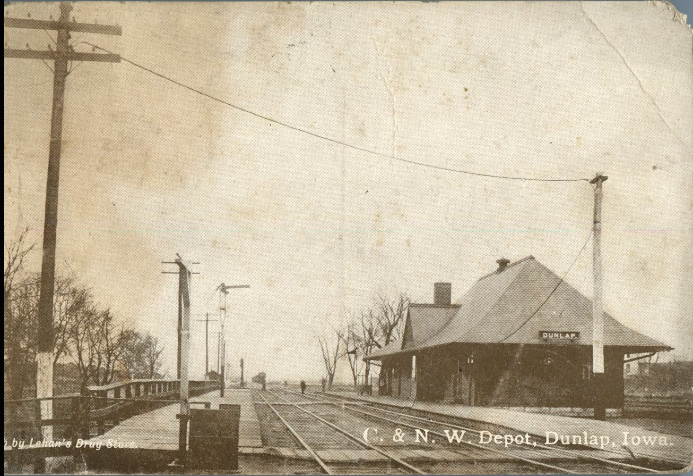
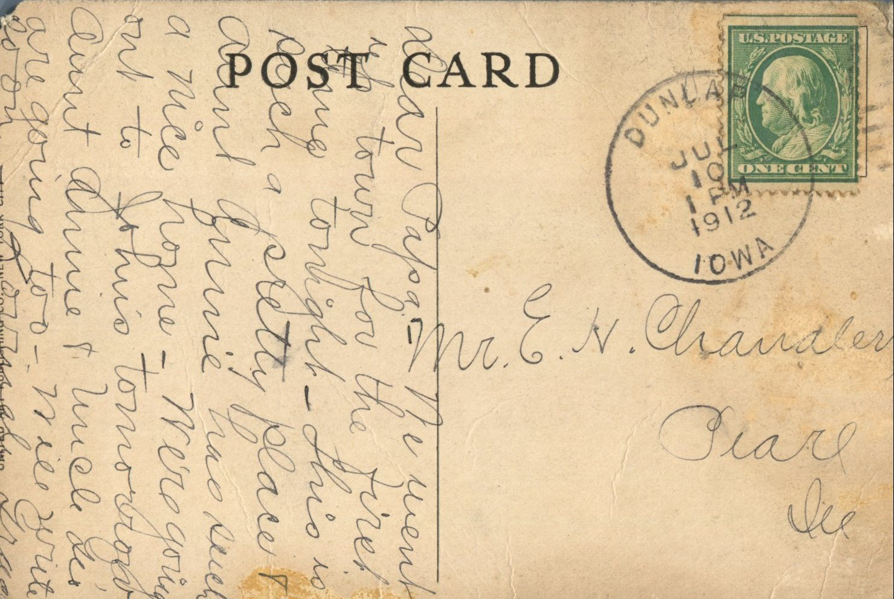

 

From: Grace Chandler, To: Elijah H. Chandler  
Mailed From: Dunlap, Iowa on July 10, 1912  
Postcard Info: United Art Publishing Co., New York City  
Picture Info: C. &amp; N. W. Depot, Dunlap, Iowa

Mr. E. H. Chandler  
Pearl, Illinois

Dear Papa,  
We went up town for the first time tonight. This is such a pretty place! Aunt Annie has such a mice home. We’re going out to John’s tomorrow. Aunt Annie and Uncle Leo are going too. Will write soon.  
Lovingly,  
Grace