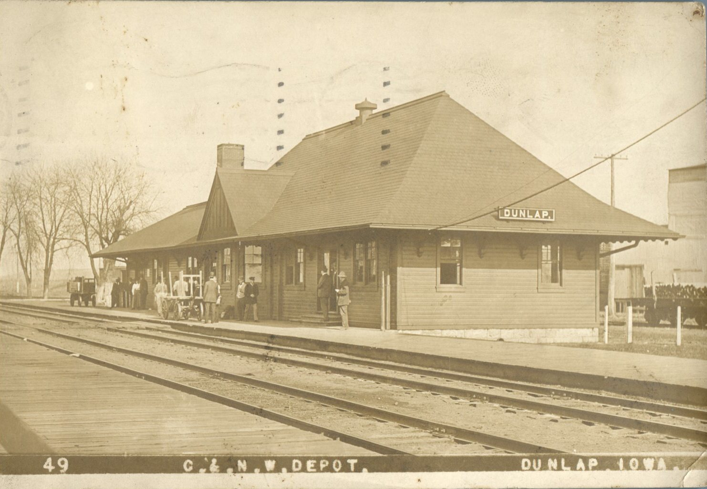
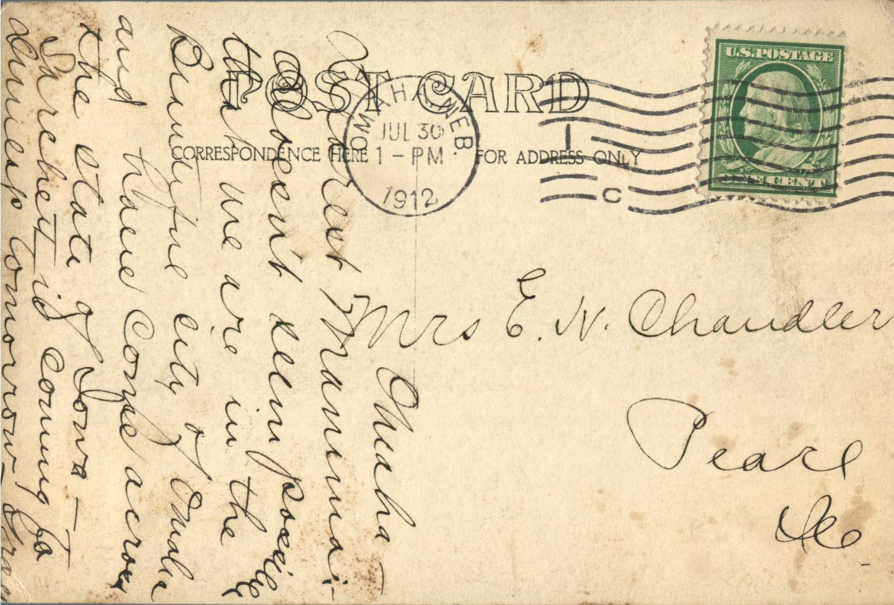

 

From: Grace Chandler, To: Jeanette Knox Chandler  
Mailed From: Omaha, Nebraska on July 30, 1912  
Picture Info: C. &amp; N. W. Depot, Dunlap, Iowa.

Mrs. E.H. Chandler  
Pearl, Illinois

Omaha  
Dearest Mamma,  
Doesn’t see possible that we are in the beautiful city of Omaha and have come across the state of Iowa. Sarchett is coming to Dunlap tomorrow.  
Grace