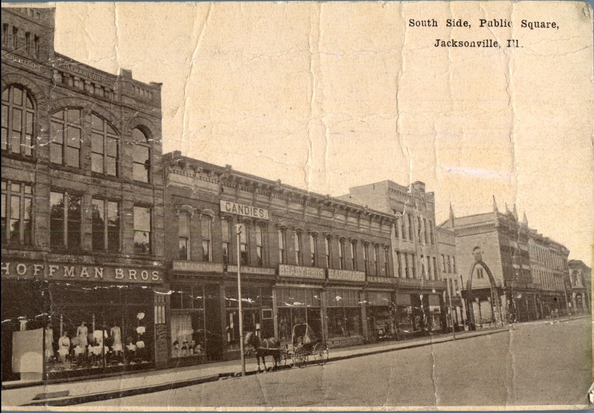
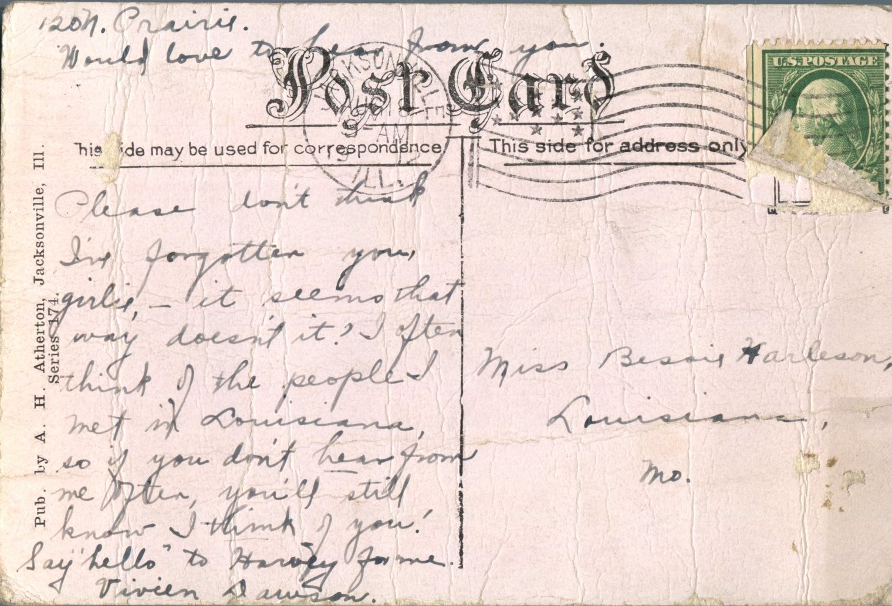

 

From: Vivien Dawson, To: Bess Harleson  
Mailed From: Jacksonville, Illinois on August 18, 1912  
Postcard Info: Pub. by A.H. Atherton, Jacksonville, Ill. Series 174.  
Picture Info:South Side, Public Square, Jacksonville, Ill.

Miss Bessie Harleson  
Louisiana, MO.

Please don’t think I’ve forgotten you girlie, – it seems that way doesn’t it? I often think of the people I met in Louisiana, so if you don’t hear from me often, you’ll still know I think of you! Say “hello” to Harvey for me.  
Vivien Dawson  
120 N. Craivie  
Would love to hear from you.